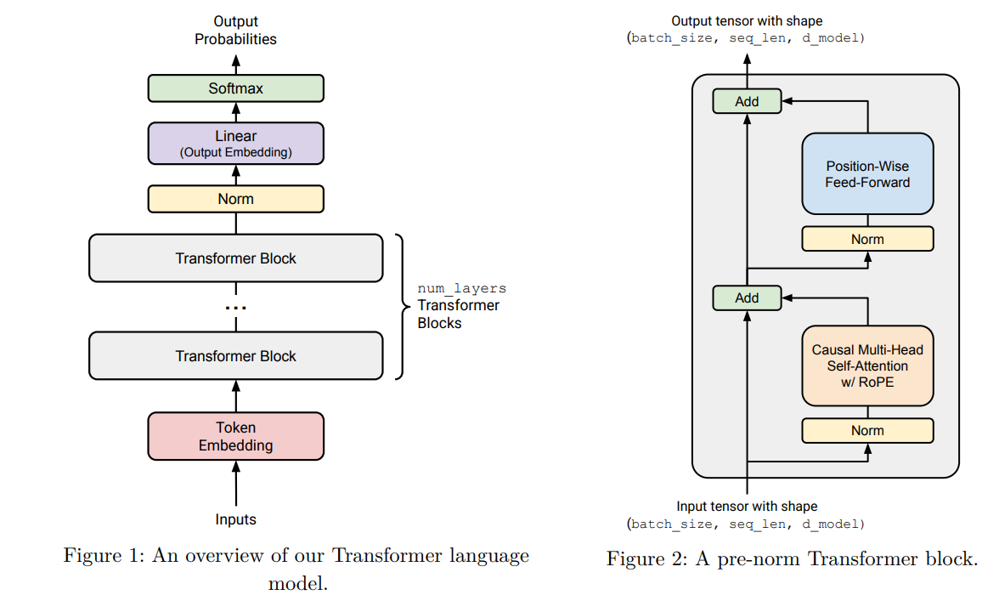
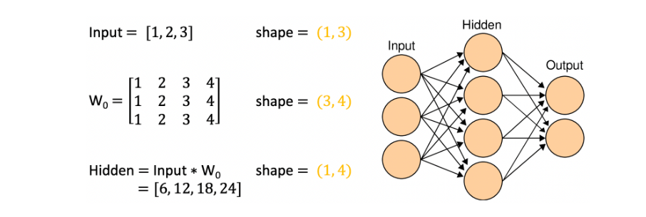
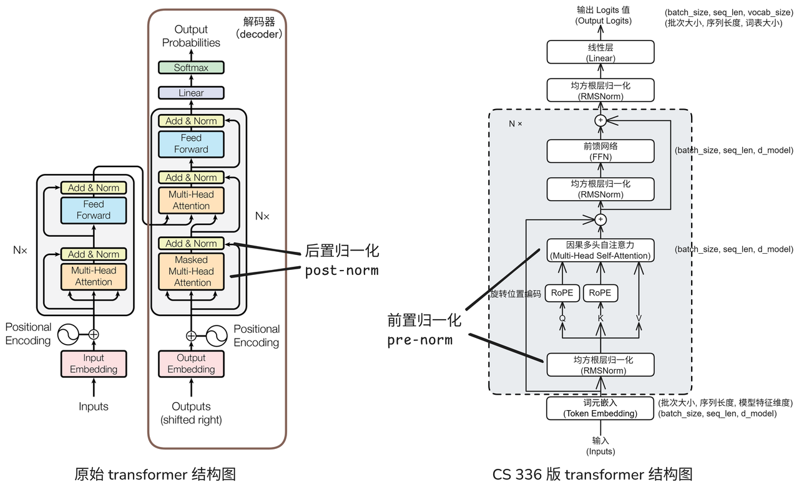
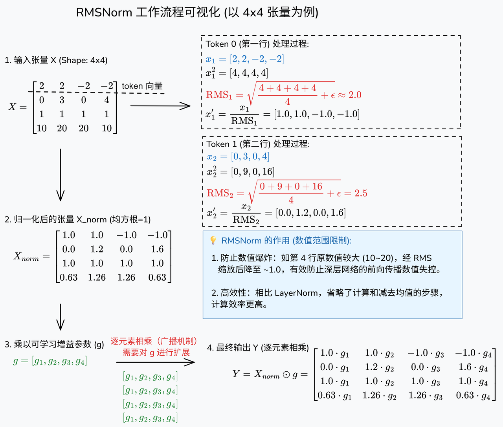
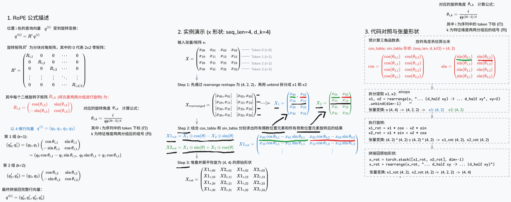
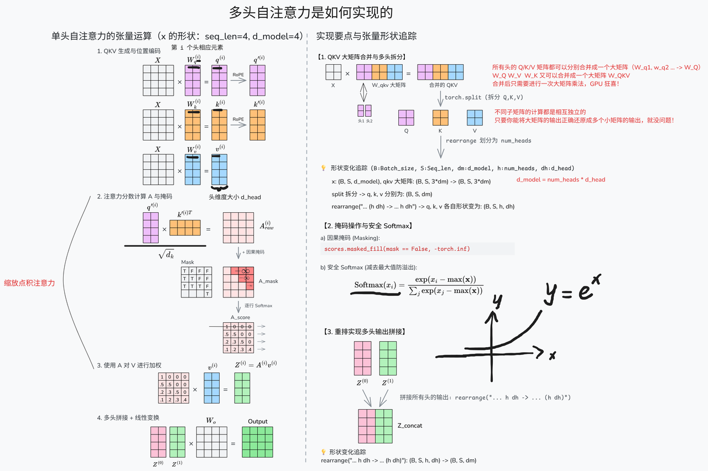
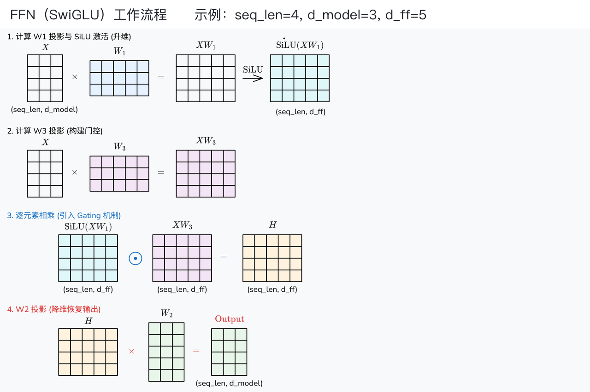
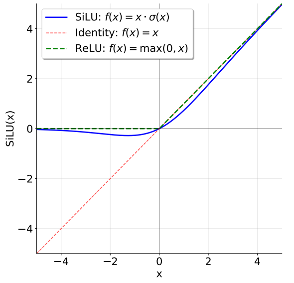
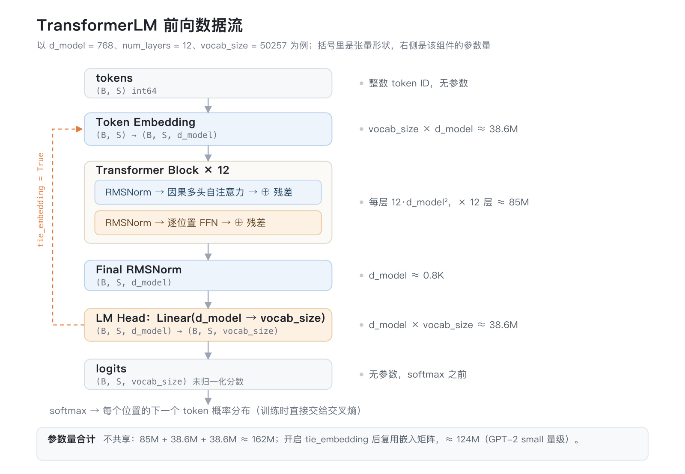

&emsp;&emsp;[CS336](https://cs336.stanford.edu/)的学习笔记，参考了b站[这就是小C_](https://space.bilibili.com/488678545/)，[intangible101](https://space.bilibili.com/3546747626326043)的视频和笔记。

&emsp;&emsp;[文本编码与 Tokenizer](/2026/07/12/CS336-1-文本编码与%20Tokenizer/)解决了"文本 → 整数 token ID"这一步，把句子切成离散编号；Transformer 则在这些编号上理解上下文、预测下一个 token。

### Transformer整体架构预览

&emsp;&emsp;语言模型接收一批句子（每个句子是一个 token ID 序列），输出每个位置上"下一个词"的概率分数（logits）：

- 输入形状：`(batch_size, sequence_length)`，整数 token ID；
- 输出形状：`(batch_size, sequence_length, vocab_size)`，即每个位置对词表中每个 token 的 next-token logits。

&emsp;&emsp;训练时用交叉熵损失衡量每个位置的预测分布与真实 next token 的差距；推理时没有"未来"的标签，就从最后一个位置的分布中采样出下一个 token，拼回序列后再重复这一过程，逐个生成后面的 token——这就是自回归（autoregressive）生成。

&emsp;&emsp;原始 Transformer 采用编码器-解码器（encoder-decoder）结构：编码器读完整输入，解码器再生成输出。现代大语言模型（GPT、LLaMA 等）统一采用 decoder-only 结构，只保留解码器，并用因果掩码保证每个位置只能看到自己和左边的 token。CS336 版 Transformer 同样是 decoder-only，每个 Transformer 块由两个子层组成，且都采用 Pre-Norm（先归一化、再过子层、最后残差相加）。



&emsp;&emsp;把上图拆成伪代码，整个前向过程其实很直观：嵌入 → 若干次（注意力 + 前馈）→ 归一化 → 输出投影。

```text
def transformer_lm(token_ids):
    x = token_embedding(token_ids)                  # (Batch, Seq_len, d_model)

    for _ in range(num_layers):
        # 子层 1：因果多头自注意力 + 残差连接
        norm_x = rmsnorm(x)
        q, k, v = linear(norm_x)                    # 通过线性层映射出查询(q)、键(k)和值(v)
        attn_out = multi_head_self_attention(rope(q), rope(k), v)  # 计算自注意力
        x = x + attn_out                            # 残差连接

        # 子层 2：前馈网络 + 残差连接
        x = x + ffn(rmsnorm(x))                     # 残差连接

    # 最终层归一化与输出映射
    logits = linear(rmsnorm(x))                     # (Batch, Seq_len, vocab_size)
    return logits
```

### 线性层

&emsp;&emsp;线性层是 Transformer 里最基础的组件：它不改变数据的组织方式，只把最后一维从 `d_in` 映射到 `d_out`。对输入 $x$ 做 $y = xW^{T}$，其中权重矩阵 $W$ 的形状是 `(d_out, d_in)`。

- 输入形状：`(batch_size, sequence_length, d_in)`；
- 输出形状：`(batch_size, sequence_length, d_out)`。


&emsp;&emsp;

&emsp;&emsp;初始化使用截断正态分布，均值 0、标准差 `sqrt(2 / (d_in + d_out))`（Xavier/Glorot 的常用形式），并截断到 `[-3σ, 3σ]`。这样做的目的是让每一层输出的方差大致保持不变，避免深层网络中激活值逐层爆炸或衰减；截断则防止极少数离群权重在训练初期造成不稳定。线性层不带 bias：在 Transformer 中 bias 对效果影响很小，省掉可以让参数更少、结构更统一。

&emsp;&emsp;`einsum` 里的 `...` 会自动广播到任意前置维度，所以同一个 `Linear` 既能处理 `(d_in,)` 的单向量，也能处理 `(B, S, d_in)` 的整批序列，不需要为不同输入形状写分支。

```python
import torch
import torch.nn as nn
from einops import rearrange, einsum


# Problem 1: 实现 linear 模块 (1 分)
class Linear(torch.nn.Module):
    def __init__(self, in_features, out_features, device=None, dtype=None):
        super().__init__() # 调用父类初始化
        '''
        in_features: int  输入特征维度
        out_features: int  输出特征维度
        device: torch.device | None = None  参数存放在哪个设备上
        dtype: torch.dtype | None = None  参数的数据类型
        '''

        # torch.empty() 只分配内存，不初始化数值；用 torch.zeros, torch.ones, torch.randn 创建张量都可以，只是会做一次无意义的填充
        self.w = nn.Parameter(torch.empty(out_features, in_features, device=device, dtype=dtype)) # nn.Linear()
        

        mean, std = 0, (2 / (in_features + out_features)) ** 0.5
        nn.init.trunc_normal_(self.w, mean=mean, std=std, a=-3*std, b=3*std)

    def forward(self, x: torch.Tensor) -> torch.Tensor:
        '''
        对输出应用线性变换 y = xA^T
        x: [..., in_features] 任意数量的 batch 维度的输入特征
        return: [..., out_features] 线性变换后的输出
        '''
        # einsum 实现矩阵乘法，等价于 y = x @ self.w.T 或者是 y = torch.matmul(x, self.w.T)
        y = einsum(x, self.w, "... d_in, d_out d_in -> ... d_out") # 对 d_in 维度执行矩阵变换，并将该操作广播到 d_in 维度前面的所有维度上
        return y
```

### 嵌入层

&emsp;&emsp;token ID 本身没有语义，只是词表里的编号。嵌入层就是一张大小为 `(vocab_size, d_model)` 的查找表：用 token ID 去索引第 0 维，取出对应的 `d_model` 维向量。

- 输入形状：`(batch_size, sequence_length)`；
- 输出形状：`(batch_size, sequence_length, d_model)`。
&emsp;&emsp;`self.embed[token_ids]` 是高级索引，结果形状为 `token_ids.shape + (d_model,)`，所以 `(B, S)` 的 ID 序列会得到 `(B, S, d_model)`。嵌入层只按 token ID 查表，同一个 token 无论出现在第几个位置，拿到的都是同一行向量——它完全不知道位置。而注意力打分只看内容，如果不额外注入位置信息，模型就无法区分同一个 token 出现在不同位置，也感知不到相对距离，这正是后面用 RoPE 的原因。

```python
# Problem 2: 实现 Embedding 模块 (1 分)
class Embedding(torch.nn.Module):
    def __init__(self, num_embeddings: int, embedding_dim: int, device=None, dtype=None, init_std: float = 1.0):
        super().__init__()
        '''
        num_embeddings: int  词表大小，取值范围 [0, num_embeddings‑1]
        embedding_dim: int  词向量的维度，也即模型特征维度 d_model
        device: torch.device | None = None  参数存放在哪个设备上
        dtype: torch.dtype | None = None  参数的数据类型
        init_std: float = 1.0  截断正态初始化的标准差；调小（如 0.02）可以避免训练初期 loss 尖刺，属于可控的实验变量
        '''

        self.embed = nn.Parameter(torch.empty(num_embeddings, embedding_dim, device=device, dtype=dtype))

        # 截断正态初始化，标准差由 init_std 给出，截断区间 [-3*std, 3*std]
        nn.init.trunc_normal_(self.embed, mean=0, std=init_std, a=-3 * init_std, b=3 * init_std)


    def forward(self, token_ids: torch.Tensor) -> torch.Tensor:
        '''
        根据 token_ids 查表取向量
        token_ids: [batch_size, seq_len]
        return: [batch_size, seq_len, embed_dim]
        '''

        # pytorch 索引操作，等价于 torch.index_select
        return self.embed[token_ids] # 用 token_ids 中的每个元素去索引 self.embed 的第 0 维，形状变化为：(batch_size, seq_len) -> (batch_size, seq_len, embed_dim)
        # id = 0 -> self.embed[0]
```

### Transformer块

&emsp;&emsp;Transformer 块里有两个子层：

1. **因果多头自注意力**：让每个 token 汇总上下文信息；
2. **逐位置前馈网络**：对每个 token 独立地做一次非线性变换，整合注意力收集到的信息。

&emsp;&emsp;每个子层都套在"归一化 → 子层 → 残差相加"的模板里。CS336 采用 Pre-Norm：先归一化再进子层，残差路径上不做任何归一化。这样梯度可以沿着残差路径从后一层"无损"地传回前一层，深层模型训练更稳定，也是 LLaMA、GPT-3 等现代模型的标准选择。与之相对的 Post-Norm 是"子层 → 残差相加 → 归一化"，原始 Transformer 用的就是它，但层数一深就容易训练困难。

$$
\begin{aligned}
\text{Pre-Norm}: \quad & y = x + \text{MHA}(\text{RMSNorm}(x)) \\
& z = y + \text{FFN}(\text{RMSNorm}(y)) \\[4pt]
\text{Post-Norm}: \quad & y = \text{RMSNorm}(x + \text{MHA}(x)) \\
& z = \text{RMSNorm}(y + \text{FFN}(y))
\end{aligned}
$$
（Pre-Norm 为默认结构，Post-Norm 为消融选项。）

&emsp;&emsp;下图左边是原始 Transformer（Post-Norm），右边是 CS336 版（Pre-Norm，RoPE 只加在 q/k 上），可以对照着看残差和归一化的位置差异。


```python
# 问题 9：实现 Transformer 块（3 分）
class TransformerBlock(nn.Module):
    def __init__(self, d_model: int, num_heads: int, d_ff: int, max_seq_len: int, rope_theta: float,
                 use_rmsnorm: bool = True, pre_norm: bool = True, ffn_gated: bool = True) -> None:
        super().__init__()
        '''
        d_model: int  Transformer 块输入维度
        num_heads: int  多头自注意力头数
        d_ff: int  前馈网络中间层维度
        max_seq_len: int  RoPE 最大序列长度
        rope_theta: float  RoPE 基数频率，传 0 或负数即关闭 RoPE（NoPE 消融）
        use_rmsnorm: bool = True   消融开关，False 时把两块 RMSNorm 都换成恒等映射
        pre_norm: bool = True      消融开关，False 时改用 Post‑Norm 结构
        ffn_gated: bool = True     消融开关，False 时 FFN 去掉门控分支
        '''
        # 子层 1：因果多头自注意力 + 残差连接
        self.mha = MultiHeadSelfAttention(d_model, num_heads, max_seq_len, rope_theta)
        self.pre_norm1 = RMSNorm(d_model, remove=not use_rmsnorm)  # 子层 1 的归一化
        # 子层 2：前馈网络 + 残差连接
        self.ffn = FFN(d_model, d_ff, gated=ffn_gated)
        self.pre_norm2 = RMSNorm(d_model, remove=not use_rmsnorm)  # 子层 2 的归一化
        self.pre_norm = pre_norm

    def forward(self, x: torch.Tensor) -> torch.Tensor:
        '''
        Pre‑Norm（pre_norm=True，默认）：
        y = x + MHA(RMSNorm(x))
        z = y + FFN(RMSNorm(y))
        Post‑Norm（pre_norm=False，消融）：
        y = RMSNorm(x + MHA(x))
        z = RMSNorm(y + FFN(y))
        x: (batch_size, seq_len, d_model)
        return: (batch_size, seq_len, d_model)
        '''
        if self.pre_norm:
            # part1：子层 1 = 多头自注意力 + 残差连接
            x = x + self.mha(self.pre_norm1(x))  # (B, S, d_model) -> (B, S, d_model)
            # part 2：子层 2 = 前馈网络 + 残差连接
            y = x + self.ffn(self.pre_norm2(x))  # (B, S, d_model) -> (B, S, d_model)
        else:
            # post-norm：残差相加之后再归一化
            x = self.pre_norm1(x + self.mha(x))  # (B, S, d_model) -> (B, S, d_model)
            y = self.pre_norm2(x + self.ffn(x))  # (B, S, d_model) -> (B, S, d_model)
        return y
```

#### 均方根归一化

&emsp;&emsp;LayerNorm 会同时做"减均值"和"除标准差"两件事；RMSNorm 观察到，在 Transformer 里减均值对效果的贡献很小，于是只保留"除以均方根"这一步，计算更省、效果接近。

$$
\text{RMSNorm}(a)_i = \frac{a_i}{\text{RMS}(a)} \cdot g_i,
\qquad
\text{RMS}(a) = \sqrt{\frac{1}{d_{\text{model}}} \sum_{i=1}^{d_{\text{model}}} a_i^2 + \varepsilon}
$$

&emsp;&emsp;其中 `g` 是可学习的增益参数（共 `d_model` 个），初始化为全 1；`eps` 通常取 `1e-5`，防止分母为 0。归一化只作用在最后一维（特征维）上，前面的 `batch`、`seq` 维各自独立处理。

&emsp;&emsp;看一个直观的例子：某一行向量是 `[2, 2, -2, -2]`，平方和为 16，均方根为 $\sqrt{16/4} = 2$，归一化后得到 `[1, 1, -1, -1]`，再逐元素乘上 $g$。数值较大的行（例如 `[10, 20, 20, 10]`）会被压到 1 附近，从而防止深层网络前向传播时数值失控。



&emsp;&emsp;数值稳定性方面，训练时权重常以 `float16/bfloat16` 存储以节省显存、提高吞吐，但低精度下平方求和容易溢出或丢精度。因此实现里先把 `x` 转成 `float32` 计算，算完再转回原 dtype——这一步对混合精度训练很关键。

```python
# Problem 3: 实现 RMSNorm (1 point)
class RMSNorm(torch.nn.Module):
    def __init__(self, d_model: int, eps: float = 1e-5, device=None, dtype=None, remove: bool = False):
        super().__init__()
        '''
        d_model: int  模型隐藏层的特征维度
        eps: float = 1e-5  数值稳定性极小值，防止分母为 0
        device: torch.device | None = None  参数存放设备
        dtype: torch.dtype | None = None  参数数据类型
        remove: bool = False  消融开关，置 True 时本层退化成恒等映射（保留结构与参数数量，方便对照实验）
        '''
        self.d_model = d_model
        # 可学习缩放参数 gamma，初始化为全 1
        self.g = nn.Parameter(torch.ones(d_model, device=device, dtype=dtype)) # (d_model, )
        self.eps = eps
        self.remove = remove

    def forward(self, x: torch.Tensor) -> torch.Tensor:
        '''
        输入形状: [..., d_model] 支持任意前置维度（如 batch_size, seq_len），最后一维为特征维度
        输出形状: [..., d_model] 与输入形状完全一致
        '''
        if self.remove:   # 消融：整层不起作用，直接把输入原样传下去
            return x

        # 记录原始精度，计算时提升到 float32 保证稳定，输出时还原精度
        in_dtype = x.dtype
        x = x.to(torch.float32)

        # 核心计算：求均方根 -> 归一化 -> 乘可学习缩放系数
        # (..., d_model) -> (..., 1)
        rms = (x.square().sum(dim=-1, keepdim=True) / self.d_model + self.eps) ** 0.5 # (..., 1)
        result = x / rms * self.g # (..., d_model) / (..., 1) * (d_model) -> (..., d_model)

        return result.to(in_dtype)
```

#### 旋转位置编码

&emsp;&emsp;自注意力本身是位置无关的：把 token 顺序打乱，注意力分数只依赖内容，不依赖谁在前谁在后。但语言是有顺序的（"狗咬人"和"人咬狗"完全不同），所以必须把位置信息注入模型。

&emsp;&emsp;RoPE（Rotary Position Embedding）的思路很巧妙：不额外加位置向量，而是根据 token 的位置，把 q、k 向量"旋转"一个角度。位置 $i$ 的旋转矩阵 $R^{i}$ 是一个分块对角矩阵，每块是一个 2×2 的旋转子矩阵：

$$
R^{i}_{k} =
\begin{pmatrix}
\cos\theta_{i,k} & -\sin\theta_{i,k} \\
\sin\theta_{i,k} & \cos\theta_{i,k}
\end{pmatrix},
\qquad
\theta_{i,k} = \frac{i}{\Theta^{(2k-2)/d}}
$$

&emsp;&emsp;其中 $i$ 是 token 位置，$k$ 是维度对的编号（$k = 1, 2, \dots, d/2$），$\Theta$ 是常数基底（GPT-2 取 10000）。不同维度对用不同频率旋转：靠前的维度转得快（高频），靠后的维度转得慢（低频），一组不同尺度的"时钟"组合起来就能唯一编码位置。

&emsp;&emsp;为什么旋转能表达相对位置？两个向量分别旋转 `θ_i` 和 `θ_j` 后再做内积，结果只依赖角度差 `θ_i - θ_j`，也就是只依赖相对位置 `i - j`。这就是 RoPE 的核心性质：注意力分数天然携带"相对距离"的信息，而且不需要额外的位置向量参数。

&emsp;&emsp;实现上不必真的构造 `d × d` 的大矩阵：把最后一维两两分组，每组独立做一次二维旋转即可。`sin/cos` 只和位置、维度有关，与具体输入无关，所以可以在初始化时预计算成查找表，并注册为 `buffer`：它会随模型一起搬运设备、保存进 `state_dict`，但不参与梯度更新。查找表的形状是 `(max_seq_len, d_k/2)`，第 `i` 行就是位置 `i` 在每一组维度上的 cos/sin 值。



&emsp;&emsp;对照代码看，有几个细节值得留意：

1. **RoPE 只作用于 q 和 k，不作用于 v**。旋转是为了让 `q · k` 携带相对位置信息；v 只负责"取什么内容"，不需要位置。
2. **两两分组是交错的**：用 `rearrange` 把 `d_k` 拆成 `(d_k/2, 2)`，再用 `unbind` 得到偶数位和奇数位两组，旋转后再用 `stack + rearrange` 合并回原顺序。
3. **不能用 `concat` 拼回去**：`concat` 会把所有偶数位放前面、奇数位放后面，顺序变成 `(x0, x2, x1, x3)`；必须用 `stack` 重新交错，才能保持与原向量一致的维度顺序。
4. **`token_positions` 是绝对位置下标**，默认由调用方传入 `0 ~ seq_len-1`，也支持非连续位置。

```python
# Problem 4: 实现 RoPE (2 points)
class RotaryPositionalEmbedding(torch.nn.Module):
    def __init__(self, theta: float, d_k: int, max_seq_len: int, device=None):
        super().__init__()
        '''
        theta: float  RoPE 的 Θ 值
        d_k: int  待编码的向量维度（一般指多头注意力层里 query 和 key 向量的维度）
        max_seq_len: int  输入的最大序列长度
        device: torch.device | None = None  存储 buffer 的设备
        '''
        
        assert d_k % 2 == 0, "RoPE 要求向量维度 d_k 必须是偶数"

        # 预计算频率与角度表
        # 旋转角度 angle[i][k] = i/(theta**(2k-2)/d), i 为 token 位置下标，k 为词向量内的元素两两分组的组号
        positions = torch.arange(max_seq_len, device=device) # 旋转角度的分子 i: [0, 1, 2, 3, ..., max_seq_len - 1]
        dim_indices = torch.arange(0, d_k, 2, device=device) # 2k‑2: [0, 2, 4, 6..., d_k - 2]; k: [1, 2, 3, ..., d_k//2]

        freqs = theta ** -(dim_indices / d_k) # 频率，也即旋转角度的分母 theta**(2k‑2)/d

        # 逐位置乘构造角度表（依赖广播机制）： (max_seq_len, 1) * (1, d_k//2) -> (max_seq_len, d_k//2)
        angle = positions[:, None] * freqs[None, :]

        cos_table = torch.cos(angle)
        sin_table = torch.sin(angle)

        # 把预先计算好的 cos 表和 sin 表注册为 buffer 缓存起来，方便以后重复使用
        self.register_buffer("cos_table", cos_table)
        self.register_buffer("sin_table", sin_table)

    def forward(self, x: torch.Tensor, token_positions: torch.Tensor) -> torch.Tensor:
        '''
        x: (..., seq_len, d_k) 输入张量
        token_positions: (..., seq_len) 存储每个 token 的位置下标，支持位置非连续的 token 序列： (1, 3, 5, 7...)
        return: (..., seq_len, d_k) 旋转位置编码后的张量
        '''
        cos = self.cos_table[token_positions] # (..., seq_len) -> (..., seq_len, d_k//2): 使用 token 位置下标 i 对 cos 表的第 0 维取元素，取得第 i 行的 cos 序列
        sin = self.sin_table[token_positions] # (..., seq_len) -> (..., seq_len, d_k//2): 使用 token 位置下标 i 对 sin 表的第 0 维取元素，取得第 i 行的 sin 序列

        # 两两分组后执行旋转
        # 把最后一维 d_k 按「每 2 个元素为一组」切开，每组 [x_even, x_odd]，全部组的偶数元素汇总为 x1，奇数元素汇总为 x2
        x1, x2 = rearrange(x, "... (half_d xy) -> ... half_d xy", xy=2).unbind(dim=-1)  # (..., seq_len, d_k) -> (..., seq_len, d_k//2, 2) -> x1/x2: (..., seq_len, d_k//2)

        # 分别对奇数位置的元素和偶数位置的元素执行不同的旋转操作
        x1_rot = x1 * cos - x2 * sin # (..., seq_len, d_k//2)
        x2_rot = x1 * sin + x2 * cos # (..., seq_len, d_k//2)

        # 拼接回原始形状
        # x_rot = torch.concat([x1_rot, x2_rot], dim=-1) # 用 concat 导致最后一维元素的顺序会变为 (x0, x2, x1, x3)，不符合原始的 (x0, x1, x2, x3)
        x_rot = torch.stack([x1_rot, x2_rot], dim=-1) # (..., seq_len, d_k//2) -> (..., seq_len, d_k//2, 2)
        x_rot = rearrange(x_rot, "... half_d xy -> ... (half_d xy)") # (..., seq_len, d_k//2, 2) -> (..., seq_len, d_k)
        return x_rot
```

#### 多头注意力机制

&emsp;&emsp;注意力机制要解决的问题是：序列里每个 token 应该"看哪些位置、各看多重"。多头自注意力（Multi-Head Self-Attention, MHA）把这件事拆成三个子模块来学：softmax 负责把分数变成概率，缩放点积注意力负责单个头的加权求和，因果多头注意力负责把多个头拼起来并加上因果掩码。下面一个一个实现。

&emsp;&emsp;先看整体流程：输入 $x$ 经过一次大矩阵乘法得到 Q、K、V，然后拆成 `num_heads` 个头并行计算注意力，每个头各自得到一份输出，最后拼接并通过输出投影 $W_O$ 融合。



&emsp;&emsp;图中左侧是单头注意力的完整张量流程，右侧是实现要点与形状追踪。整个过程可以记成四步：

1. QKV 投影与多头拆分；
2. 打分、缩放、掩码、softmax；
3. 用注意力权重对 V 加权；
4. 多头拼接 + 输出投影。

&emsp;&emsp;图里的例子是 `seq_len = 4`、`d_model = 4`、`num_heads = 2`，所以每个头的维度 $d_{\text{head}} = d_{\text{model}} / \text{num\_heads} = 2$，图中每个头的 q、k、v 都是 `(4, 2)`：**行是 4 个 token，列是这个头的 2 维特征**。如果把两个头合起来看，拆分之前的 q、k、v 则是 `(4, 4)`。

&emsp;&emsp;Q、K、V 是同一份输入 $x$ 经过三个不同权重矩阵投影得到的，分工不同：

- $Q$（query）：当前位置"想找什么信息"；
- $K$（key）：每个位置"以什么特征被检索"；
- $V$（value）：每个位置"实际提供的内容"。

&emsp;&emsp;三者串起来就是一次注意力计算：先用 $QK^{T}$ 算出两两匹配分数，除以 $\sqrt{d_k}$ 缩放、加上掩码，再 softmax 得到每行和为 1 的权重 $A$，最后用 $A$ 对 $V$ 加权求和。

$$
S = \frac{QK^{T}}{\sqrt{d_k}}, \qquad A = \text{softmax}(S), \qquad O = AV
$$

&emsp;&emsp;在这个例子里，$QK^{T}$ 是 `(4, 2) @ (2, 4) -> (4, 4)`，第 $i$ 行第 $j$ 列就是 token $i$ 与 token $j$ 的相关性；$A$ 同样是 `(4, 4)`，每行表示"token $i$ 把多少注意力分给各个位置"；$AV$ 是 `(4, 4) @ (4, 2) -> (4, 2)`，输出第 $i$ 行就是 token $i$ 聚合到的内容。

##### softmax

&emsp;&emsp;softmax 把任意实数向量映射成概率分布：每个值都是正数，且总和为 1。MHA 用它把原始注意力分数变成"每个位置应该分到多少注意力"。

$$
\text{softmax}(x)_i = \frac{\exp(x_i)}{\sum_j \exp(x_j)}
$$

&emsp;&emsp;直接按定义计算会有溢出风险：当某个 $x_i$ 很大时，$\exp(x_i)$ 可能超出浮点数范围变成 `inf`，分母也随之变成 `inf`，最后得到 `nan`。由于 softmax 对输入整体平移不变，实现时先减去该维度的最大值：

$$
\text{softmax}(x)_i = \frac{\exp(x_i - \max_j x_j)}{\sum_j \exp(x_j - \max_j x_j)}
$$

&emsp;&emsp;减完之后最大的指数项是 $\exp(0)=1$，其余项都不超过 1，数值就稳定了。这就是代码里 `x -= x.max(...)` 那一行的作用——它不改变数学结果，只改变计算的数值稳定性。

```python
# Problem 5: 实现 softmax (1 point)
def softmax(x: torch.Tensor, i: int) -> torch.Tensor:
    '''
    x: 输入张量，支持任意维度
    i: int  待计算 softmax 的维度编号
    返回形状: 与输入 x 形状完全一致
    '''

    # .max() 的返回值是一个元组 (最大值张量, 最大值下标张量)，元组里的元素不可修改，列表里的元素可以修改
    x -= x.max(dim=i, keepdim=True)[0] # 假设 i = -1: x: (... dim) x.max: (... 1) -> (... dim)

    return torch.exp(x) / torch.exp(x).sum(dim=i,  keepdim=True) # 假设 i = -1: x: (... dim) x.sum: (... 1) -> (... dim)
```

&emsp;&emsp;两处 `keepdim=True` 的作用是一样的：**保留被归约的那一维，让它变成大小为 1，这样广播才对得上**。
```text
x = [[1, 2],
     [3, 0]]                     # (2, 2)，沿最后一维做 softmax

# keepdim=True
row_max = [[2],
           [3]]                  # (2, 1)
x - row_max -> [[-1,  0],
                [ 0, -3]]        # 每行减自己的最大值

# keepdim=False
row_max = [2, 3]                 # (2,)
x - row_max -> [[-1, -1],
                [ 1, -3]]        # 每列减该列的最大值
```

&emsp;&emsp;两种写法都不会报错，但第二种把"每一行的最大值"减成了"每一列的最大值"。继续 exp、再除以行和（这一步仍用 `keepdim=True`），得到的"softmax"是 `[[0.5, 0.5], [0.9820, 0.0180]]`，正确答案是 `[[0.2689, 0.7311], [0.9526, 0.0474]]`——每行仍然和为 1，数值却已经错了。

&emsp;&emsp;原因就是省掉 `keepdim=True` 后，被归约的维度会被删掉，形状从 `(..., 1)` 变成 `(...)`；PyTorch 的广播从最后一维往前对齐，这个 `(...)` 会被当成"贴在最后"的维度。加上 `keepdim=True` 后，就不用关心输入有多少维、`i` 具体是哪一维。

&emsp;&emsp;另外，`x.max(dim=i)` 返回的是 `(最大值, 最大值下标)` 这个命名元组，所以代码用 `[0]` 取最大值；也可以写成 `.values` 或直接用 `x.amax(dim=i, keepdim=True)`。

##### 缩放点积注意力

&emsp;&emsp;缩放点积注意力是单个注意力头的核心运算：用查询 $Q$ 和键 $K$ 的点积衡量"每个位置有多相关"，再把这组相关性作为权重，对值 $V$ 做加权求和。

$$
\text{Attention}(Q, K, V) = \text{softmax}\left(\frac{QK^{T}}{\sqrt{d_k}}\right)V
$$

&emsp;&emsp;式中的 $\sqrt{d_k}$ 用来把点积的方差固定住。假设 $q$、$k$ 各维独立、均值 0、方差 1，则每一项方差为 1，累加后

$$
\text{Var}(s) = \text{Var}\left(\sum_{i=1}^{d_k} q_i k_i\right) = d_k,
\qquad
\text{std}(s) = \sqrt{d_k}
$$

&emsp;&emsp;维度越大分数波动越大：$d_k = 64$ 时标准差约 8，不同位置差出 10 很常见，而差 10 对应 $e^{10} \approx 22026$ 倍的权重比，softmax 于是接近 one-hot：

$$
\text{softmax}([10, 0]) \approx [0.99995,\; 0.00005],
\qquad
\text{softmax}([1, 0]) \approx [0.731,\; 0.269]
$$

&emsp;&emsp;此时输出几乎等于某一个位置的 $V$，注意力退化成"硬查表"；梯度也会消失。softmax 的雅可比是

$$
J = \operatorname{diag}(p) - p p^{T},
\qquad
J_{ij} = p_i(\delta_{ij} - p_j)
$$

&emsp;&emsp;即对角线为 $p_i(1-p_i)$、其余为 $-p_i p_j$；$p$ 接近 one-hot 时这些项都趋于 0，梯度传到 $q$、$k$ 时已经所剩无几。

$$
\text{Var}\left(\frac{s}{\sqrt{d_k}}\right) = \frac{d_k}{d_k} = 1
$$

&emsp;&emsp;除以 $d_k$ 会把方差压到 $1/d_k$，softmax 接近均匀分布，注意力失去选择性。缩放又是单调变换，argmax 不变——它调整的是权重分布的陡峭程度和梯度大小。

&emsp;&emsp;注意力掩码（mask）用来限制哪些位置可见：`mask=True` 的位置保留，`False` 的位置在 softmax 之前填成 $-\infty$，这样它们的权重就会变成 0。因果注意力正是用一张下三角掩码，让位置 $i$ 只能看到 $j \le i$。

&emsp;&emsp当 `seq_len = 4` 时掩码长这样：

```text
True   False  False  False
True   True   False  False
True   True   True   False
True   True   True   True
```

```python
# Problem 6: 实现缩放点积注意力 (5 points)
def scaled_dot_product_attention(
    q: torch.Tensor,
    k: torch.Tensor,
    v: torch.Tensor,
    mask: torch.Tensor = None
) -> torch.Tensor:
    """
    实现缩放点积注意力
    q, k: (batch_size, ..., seq_len, d_k)
    v: (batch_size, ..., seq_len, d_v)
    mask: 可选布尔张量 (seq_len, seq_len)
          mask=True 代表该位置允许参与注意力权重计算, False 权重置零
    return: (batch_size, ..., seq_len, d_v)
    """

    # scores = q @ k.T
    scores = einsum(q, k, "... seq_len1 d, ... seq_len2 d -> ... seq_len1 seq_len2") # (..., seq_len1, d_k), (..., seq_len2, d_k) → (..., seq_len1, seq_len2)
   
    scores /= (q.shape[-1] ** 0.5)  # 使用 sqrt(d_k) 缩放，防止维度变大后内积过大导致 softmax 饱和
    
    if mask is not None:
        scores = scores.masked_fill(mask == False, -torch.inf) # 对 False 位置（对应于上三角除对角线上的元素）进行填充，填充值为负无穷，经过 softmax 后权重 ≈0
    
    scores = softmax(scores, -1) # 在最后一个维度上做 softmax

    # y = scores @ v
    y = einsum(scores, v, "... seq_len1 seq_len2, ... seq_len2 d -> ... seq_len1 d") # (..., seq_len1 seq_len2), (..., seq_len2 d_v) → (..., seq_len1 d_v)
    return y
```

&emsp;&emsp;代码里的 `seq_len1`、`seq_len2` **不是两个句子**，而是同一个序列里的两种位置角色：`seq_len1` 是查询位置（分数矩阵的行），`seq_len2` 是键位置（列）。自注意力里 q、k、v 都是同一个 $x$ 分别经过三个权重矩阵投影得到的，所以 `seq_len1` 和 `seq_len2` 都等于输入序列长度 $S$，分数矩阵是 $S \times S$ 的方阵。

```text
q:     (..., seq_len1, d)
k:     (..., seq_len2, d)
scores:(..., seq_len1, seq_len2)   # 第 i 行第 j 列 = q_i · k_j
```

&emsp;&emsp;第二个 einsum 里 `seq_len2` 变成了共享轴，会被求和掉，`seq_len1` 保留下来——这正是"用权重对 V 加权"的含义：对每个查询位置 $i$，把 $S$ 个 value 按权重加起来，输出仍然是 $S$ 个位置。

&emsp;&emsp;两个长度不同的情况确实存在，只是不发生在自注意力里：编码器-解码器注意力的 query 来自解码器、key 来自编码器，长度可以不同；KV cache 推理时 query 只有 1 个位置，key 有 $t$ 个历史位置。这也是代码把两个轴分开命名的原因——同一份实现可以直接兼容这些场景。

##### 多头自注意力

&emsp;&emsp;单个注意力头只能从一种"视角"看序列；多个头可以让模型同时关注不同的关系——有的头关注语法结构，有的头关注指代，有的头关注局部搭配。多头注意力的做法是：把 $d_{\text{model}}$ 维拆成 $h$ 个头，每个头维度 $d_{\text{head}} = d_{\text{model}}/h$，各自独立做一次缩放点积注意力，最后拼接并投影回 $d_{\text{model}}$。

$$
\text{MultiHead}(x) = \text{Concat}(\text{head}_1, \dots, \text{head}_h)\,W_{O}
$$

$$
\text{head}_i = \text{Attention}\left(xW_{i}^{Q},\; xW_{i}^{K},\; xW_{i}^{V}\right),
\qquad
W_{i}^{Q}, W_{i}^{K}, W_{i}^{V} \in \mathbb{R}^{d_{\text{model}} \times d_{\text{head}}}
$$

&emsp;&emsp;这里 $x$ 的每一行是一个 token，所以 $xW_{i}^{Q}$ 就是把 $(S, d_{\text{model}})$ 投影成 $(S, d_{\text{head}})$，得到第 $i$ 个头的查询；$K$、$V$ 同理。拼接后是 $(S, d_{\text{model}})$，再乘 $W_{O} \in \mathbb{R}^{d_{\text{model}} \times d_{\text{model}}}$ 把各头的信息混合回原维度。按头写出的 $W_{i}^{Q}$ 只是数学上的拆解，代码把所有头沿输出维拼成一个 `(d_model, 3 * d_model)` 的 $W^{QKV}$，算完再切分——所以 `Linear` 里存的是 `(3 * d_model, d_model)`，正是它的转置。

&emsp;&emsp;实现时有三个设计要点：

1. **QKV 投影合并成一个大矩阵**：`Linear(d_model, 3 * d_model)` 一次算出 Q、K、V，比分别做三次矩阵乘法更省显存访问；
2. **RoPE 只加在 Q、K 上**：位置信息通过 $QK^{T}$ 进入注意力分数，V 不需要旋转；
3. **因果掩码用下三角矩阵**：`torch.tril(torch.ones(...))` 生成，保证每个位置只能看到自己和左边。
```python
# Problem 7: 实现因果多头自注意力 MHA (5 points)
class MultiHeadSelfAttention(nn.Module):
    def __init__(self, d_model: int, num_heads: int, max_seq_len: int, rope_theta: float) -> None:
        super().__init__()
        '''
        d_model: int  Transformer 块输入维度
        num_heads: int  注意力头数
        max_seq_len: int  RoPE 最大序列长度
        rope_theta: float  RoPE 基数频率
        '''

        self.d_model = d_model
        self.d_head = d_model // num_heads   # 计算每个头的向量维度
        self.num_heads = num_heads

        self.w_qkv = Linear(d_model, 3 * d_model) # 所有头的 qkv 矩阵合并成一个大矩阵: 输出维度 out_dim = num_heads * d_head * 3

        # rope_theta>0 启用旋转位置编码；d_head为每个头维度
        self.rope = RotaryPositionalEmbedding(theta=rope_theta, d_k=self.d_head, max_seq_len=max_seq_len) if rope_theta > 0 else None

        self.w_output = Linear(d_model, d_model) # 输出投影矩阵

    def forward(self, x: torch.Tensor, token_positions: torch.Tensor=None) -> torch.Tensor:
        '''
        :param x: 输入张量: (batch_size, seq_len, d_model)
        :param token_positions: 每个 token 的位置下标 (batch_size, seq_len)，为 None 自动生成 0~seq_len‑1
        :return: (batch_size, seq_len, d_model)
        '''

        qkv = self.w_qkv(x) # (B, S, d_model) -> (B, S, 3*d_model)
        
        q, k, v = torch.split(qkv, self.d_model, dim=-1) # (B, S, 3*d_model) -> q/k/v: (B, S, d_model)

        # 拆分多头：把 d_model 拆成 num_heads × d_head，num_heads 放到 seq 前面，匹配 rope 的代码（回顾一下 rope 对输入 x 的要求）
        # (B, S, num_heads*d_head) → (B, num_heads, S, d_head)
        q = rearrange(q, "... seq (num_heads d_head) -> ... num_heads seq d_head", num_heads=self.num_heads, d_head=self.d_head)
        k = rearrange(k, "... seq (num_heads d_head) -> ... num_heads seq d_head", num_heads=self.num_heads, d_head=self.d_head)
        v = rearrange(v, "... seq (num_heads d_head) -> ... num_heads seq d_head", num_heads=self.num_heads, d_head=self.d_head)

        seq_len = x.shape[1]

        
        if self.rope is not None: # 是否使用 rope
            if token_positions is None:
                token_positions = torch.arange(seq_len, device=x.device) # 未传入位置时默认连续位置 0,1,2...seq_len‑1
            q = self.rope(q, token_positions)
            k = self.rope(k, token_positions)

        # 使用 tril(lower triangle) 构造下三角矩阵，下三角位置为全 1，其他位置为全 0
        mask = torch.tril(torch.ones((seq_len, seq_len), device=q.device)).bool() # 掩码矩阵 (seq_len, seq_len)：只允许看当前以及历史 token，不能看未来 token

        output_head = scaled_dot_product_attention(q, k, v, mask) # (B, n_head, S, d_head) -> (B, n_head, S, d_head)，B 和 n_head 均为批次维度，执行广播操作

        output_head = rearrange(output_head, "... num_heads seq d_head -> ... seq (num_heads d_head)") # 多头结果拼接: (B, n_heads, S, d_head) → (B, S, n_heads*d_head=d_model)
        
        output = self.w_output(output_head) # 输出层投影: (B, S, d_model) -> (B, S, d_model)
        
        return output
```

#### 逐位置编码

&emsp;&emsp;FFN 是 Transformer 块里的第二个子层。注意力负责让 token 之间交换信息，FFN 则对每个位置**独立**地做同一次非线性变换——"逐位置"说的就是每个 token 各自过一遍这个 MLP，位置之间不发生任何交互。正因为没有跨 token 依赖，实现时只需要对最后一维做映射，`(B, S, d_model)` 可以整块送进去，不用写循环。

&emsp;&emsp;原始 Transformer 的 FFN 是"两层线性 + 中间 ReLU"：先升到 $d_{ff}$（通常取 $4d_{\text{model}}$），再降回 $d_{\text{model}}$。现代大模型（LLaMA、Qwen 等）普遍换成 SwiGLU：

$$
\text{FFN}(x) = W_2\left(\text{SiLU}(W_1 x) \odot W_3 x\right),
\qquad
\text{SiLU}(x) = x\,\sigma(x) = \frac{x}{1+e^{-x}}
$$



&emsp;&emsp;图中四步正好对应公式里的四件事：先升维（$W_1$）、再激活（SiLU）、然后用另一条支路（$W_3$）逐元素门控、最后降维（$W_2$）。相比原始 FFN，SwiGLU 改了两处：

1. **激活函数换成 SiLU**：ReLU 在负半轴梯度恒为 0，神经元一旦"死掉"就再不更新；SiLU 平滑、负值处仍有非零梯度，反向传播更顺。
2. **加了一条 GLU 门控分支**：$W_3x$ 不做激活，直接当成逐元素的门，去缩放 $\text{SiLU}(W_1x)$ 的每个通道。这样既保留非线性，又给梯度留了一条线性通路（$W_3x$ 本身是线性的）。



&emsp;&emsp;代价是多了一个 $W_3$：参数量从 $2 d_{\text{model}} d_{ff}$ 变成 $3 d_{\text{model}} d_{ff}$。为了和原始 FFN 对齐，中间维度从 $4d_{\text{model}}$ 缩到 $\frac{8}{3}d_{\text{model}}$，两者参数量正好相等：

$$
3 \cdot d_{\text{model}} \cdot \frac{8}{3}d_{\text{model}} = 8 d_{\text{model}}^2 = 2 \cdot d_{\text{model}} \cdot 4d_{\text{model}}
$$

```python
# 问题 8：实现逐位置前馈网络（2 分）
class FFN(torch.nn.Module):
    def __init__(self, d_model: int, d_ff: int=512, device=None, dtype=None, gated: bool = True):
        super().__init__()
        '''
        d_model: int  模型隐藏层/词向量的维度
        d_ff: int  前馈网络中间层维度，由调用方 train_llm.py 按是否门控算好后传入
        device: torch.device | None = None  参数存放设备
        dtype: torch.dtype | None = None  参数的数据类型
        gated: bool = True  消融开关，置 False 时退化成不带门控的普通 SiLU 前馈网络（即不建 w3）
        '''
        # 此处编写你的参数创建代码
        # 127 // 64 = 1,  1 * 64 = 64,
        # 这里直接采用传进来的 d_ff（调用方按 8/3 * d_model 或 4 * d_model 对齐到 64 的倍数算好）。
        # 注意别再按 8/3 * d_model 自己重算一遍：那样 --no_gated_ffn 传进来的 4 * d_model 会被丢掉，
        # 「去掉门控后参数量对齐」就失效了，消融结论会和参数量变化混在一起。
        self.d_ff = d_ff
        self.gated = gated
        self.w1, self.w3 = Linear(d_model, self.d_ff, device=device, dtype=dtype), Linear(d_model, self.d_ff, device=device, dtype=dtype)
        self.w2 = Linear(self.d_ff, d_model, device=device, dtype=dtype)
        if not gated:        # 消融：删掉门控分支后，参数量减少约三分之一
            self.w3 = None

    def forward(self, x: torch.Tensor) -> torch.Tensor:
        '''
        FFN(x) = W2(SiLU(W1*x) ⊙ W3*x)   gated=True  门控版本（SwiGLU）
        FFN(x) = W2(SiLU(W1*x))          gated=False 普通版本（plain SiLU）
        ⊙ 代表逐‑元素相乘
        x: (batch_size, seq_len, d_model)
        return: (batch_size, seq_len, d_model)
        '''
        y1 = self.w1(x)                          # (B, S, d_model) -> (B, S, d_ff)  W1 线性映射
        y13 = y1 * torch.sigmoid(y1)             # SiLU(x) = x * sigmoid(x)，用 torch.sigmoid 保证数值稳定
        if self.gated:
            # GLU 门控：SiLU 分支再与 W3 分支逐元素相乘
            y13 = y13 * self.w3(x)               # (B, S, d_ff) ⊙ (B, S, d_ff) -> (B, S, d_ff)
        return self.w2(y13)                      # (B, S, d_ff) -> (B, S, d_model)  输出投影
```

### 完整Transformer的实现

&emsp;&emsp;所有组件就位后，按顺序串起来就是完整的语言模型：

$$
\text{logits} = W_{\text{head}}\,\text{RMSNorm}\left(\text{Block}_L\left(\cdots \text{Block}_1\left(\text{Emb}(t)\right)\cdots\right)\right)
$$

&emsp;&emsp;前向过程只有三步：查表嵌入、堆叠的块、最终归一化加预测头。形状上除了入口和出口，中间全程保持 `(B, S, d_model)`：

```text
tokens:      (B, S)                 int64
embed:       (B, S, d_model)
block × L:   (B, S, d_model)        每层输入输出形状完全相同
final_norm:  (B, S, d_model)
llm_head:    (B, S, vocab_size)     未归一化的 logits
```



&emsp;&emsp;几个容易忽略的点：

1. **最后的 RMSNorm 不能省**。Pre-Norm 的残差主干上没有归一化，第 $L$ 层输出的仍是"原始激活"，尺度会随层数累积；预测头直接拿它做投影，数值容易飘。补一个 final norm，把进入 head 的向量拉回正常范围。
2. **输出的是 logits，不是概率**。`Linear(d_model, vocab_size)` 之后还差一步 softmax，但训练时不该自己算：`F.cross_entropy` 内部会做 log-softmax，先 softmax 再取 log 反而掉精度。只有生成文本时才需要显式 softmax。
3. **`nn.Sequential` 只是省事**。块与块之间没有额外操作，所以可以直接把 `num_layers` 个 `TransformerBlock` 塞进 `Sequential`；它内部就是一个 for 循环，等价于手写循环逐个调用。

&emsp;&emsp;`tie_embedding=True` 时，预测头与词嵌入共享同一份权重。两者形状都是 `(vocab_size, d_model)`（`Linear` 存的是 `(out, in)`，正好对得上），共享能省下 `vocab_size × d_model` 个参数。代码用 `self.llm_head.w = self.embed.embed` 让两个模块指向同一个 `nn.Parameter`，所以 `state_dict` 里只存一份、梯度也只累加一次。赋值之后**不能**再对 `llm_head` 做初始化，否则会把共享的张量整个覆盖掉。

&emsp;&emsp;按参数量拆一下，一个块里就是注意力 $4d^2$（`w_qkv` 占 $3d^2$、`w_output` 占 $d^2$）加 FFN $8d^2$，共 $12d^2$。以 `d_model = 768`、`vocab_size = 50257`、12 层为例：块部分 $12 \times 12 \times 768^2 \approx 85\text{M}$，嵌入 $50257 \times 768 \approx 38.6\text{M}$，合计约 124M——正是 GPT-2 small 的量级（不共享权重的话，预测头还要再算 38.6M，总参数会涨到约 162M）。

&emsp;&emsp;那几个消融开关（`use_rmsnorm`、`pre_norm`、`ffn_gated`、`rope_theta <= 0`）在 `TransformerLM.__init__` 里原样透传给每个块，改一处就能对比"有/没有 RMSNorm""Pre/Post-Norm""门控/非门控 FFN""RoPE/NoPE"四组变体。`context_length` 同时决定了 RoPE 的查找表长度，也就是模型能处理的最长序列。

```python
# 问题 10：实现 Transformer 语言模型（3 分）
class TransformerLM(nn.Module):
    def __init__(
        self,
        d_model: int,
        num_heads: int,
        d_ff: int,
        vocab_size: int,
        context_length: int,
        num_layers: int,
        rope_theta: float,
        use_rmsnorm: bool = True,
        pre_norm: bool = True,
        ffn_gated: bool = True,
        tie_embedding: bool = False,
        embed_init_std: float = 1.0
    ) -> None:
        super().__init__()
        '''
        d_model: int  Transformer 块输入维度
        num_heads: int  多头自注意力头数
        d_ff: int  前馈网络中间层维度
        vocab_size: int  词表大小，决定词元嵌入矩阵维度
        context_length: int  最大上下文长度，决定 RoPE 的 sin/cos 缓存长度
        num_layers: int  Transformer 块堆叠层数
        rope_theta: float  RoPE 基数频率，传 0 或负数即关闭 RoPE（NoPE 消融）
        use_rmsnorm: bool = True      消融开关，False 时移除全部 RMSNorm
        pre_norm: bool = True         消融开关，False 时改用 Post‑Norm
        ffn_gated: bool = True        消融开关，False 时 FFN 去掉门控分支
        tie_embedding: bool = False   消融/性能优化开关，True 时输出头与输入嵌入共享同一个权重矩阵
        embed_init_std: float = 1.0   嵌入层初始化标准差
        '''
        self.tie_embedding = tie_embedding
        self.embed = Embedding(vocab_size, d_model, init_std=embed_init_std)         # 词元嵌入
        self.transformerBlocks = nn.Sequential(
            *[TransformerBlock(d_model, num_heads, d_ff, context_length, rope_theta=rope_theta,
                               use_rmsnorm=use_rmsnorm, pre_norm=pre_norm, ffn_gated=ffn_gated)
              for _ in range(num_layers)] # 列表推导式
        )                                                                             # num_layers 层 Transformer 块堆叠

        '''
        # 等价写法
        self.transformerBlocks = []
        
        for i in range(num_layers):
            trans_i = TransformerBlock(d_model, num_heads, d_ff, context_length, rope_theta=rope_theta)
            self.transformerBlocks.append(trans_i)    
        
        ===forward===
        # 输入 x 按顺序通过所有块的处理
        for block in self.transformerBlocks:
            x = block(x)
            
        '''
        self.final_norm = RMSNorm(d_model, remove=not use_rmsnorm)                   # 最终层归一化
        self.llm_head = Linear(d_model, vocab_size)                                   # 输出投影/预测头
        if tie_embedding:
            # 权重共享：输出头直接复用嵌入矩阵，省下一份 vocab_size × d_model 的参数
            # 注意这里不能再对 llm_head.w 做一次独立初始化，否则会破坏"共享同一个张量"的语义
            self.llm_head.w = self.embed.embed

    def forward(self, tokens: torch.Tensor) -> torch.Tensor:
        '''
        输入: (batch_size, seq_len) 整数 token IDs
        输出: (batch_size, seq_len, vocab_size) 下一个 token 的 logits
        '''
        x_embed = self.embed(tokens)                                # (B, S) -> (B, S, d_model)
        x_blocks = self.transformerBlocks(x_embed)                 # (B, S, d_model) -> (B, S, d_model)
        llm_output = self.llm_head(self.final_norm(x_blocks))      # (B, S, d_model) -> (B, S, vocab_size)
        return llm_output
```
