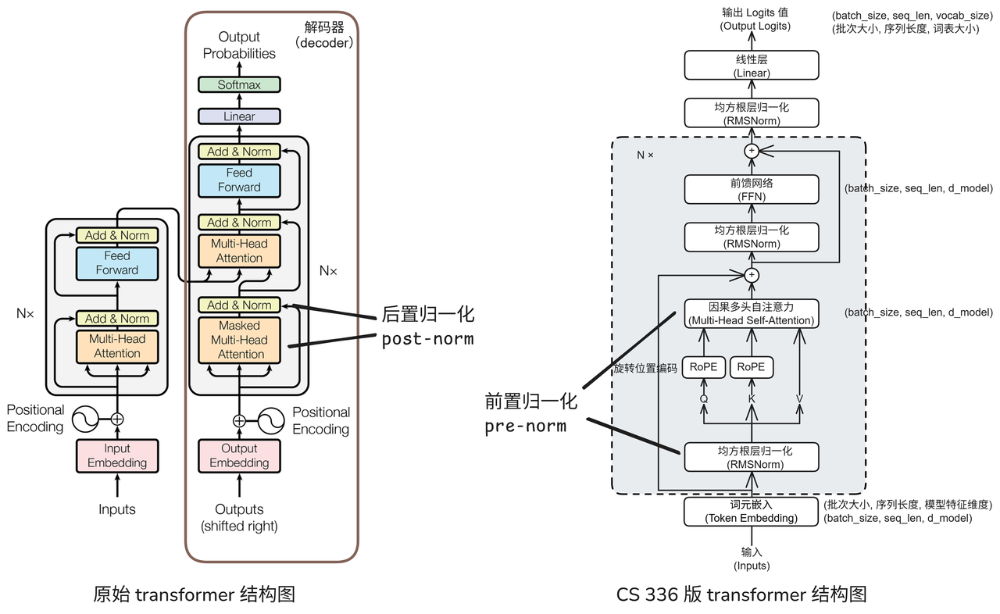

&emsp;&emsp;[CS336](https://cs336.stanford.edu/)的学习笔记，参考了b站[这就是小C_](https://space.bilibili.com/488678545/)，[intangible101](https://space.bilibili.com/3546747626326043)的视频和笔记。

### Transformer整体架构预览



### 线性层

```python
import torch
import torch.nn as nn
from einops import rearrange, einsum


class Linear(torch.nn.Module):
    def __init__(self, in_features, out_features, device=None, dtype=None):
        super().__init__()
        '''
        in_features: int  输入特征维度
        out_features: int  输出特征维度
        device: torch.device | None = None  参数存放在哪个设备上
        dtype: torch.dtype | None = None  参数的数据类型
        '''

        self.w = nn.Parameter(torch.empty(out_features, in_features, device=device, dtype=dtype))

        mean, std = 0, (2 / (in_features + out_features)) ** 0.5
        nn.init.trunc_normal_(self.w, mean=mean, std=std, a=-3 * std, b=3 * std)

    def forward(self, x: torch.Tensor) -> torch.Tensor:
        '''
        对输入应用线性变换 y = xW^T
        x: [..., in_features] 任意数量 batch 维度的输入特征
        return: [..., out_features] 线性变换后的输出
        '''
        y = einsum(x, self.w, "... d_in, d_out d_in -> ... d_out")
        return y
```

### 嵌入层

```python
class Embedding(torch.nn.Module):
    def __init__(self, num_embeddings: int, embedding_dim: int, device=None, dtype=None, init_std: float = 1.0):
        super().__init__()
        '''
        num_embeddings: int  词表大小，取值范围 [0, num_embeddings-1]
        embedding_dim: int  词向量的维度，也即模型特征维度 d_model
        device: torch.device | None = None  参数存放在哪个设备上
        dtype: torch.dtype | None = None  参数的数据类型
        init_std: float = 1.0  截断正态初始化的标准差
        '''

        self.embed = nn.Parameter(torch.empty(num_embeddings, embedding_dim, device=device, dtype=dtype))

        nn.init.trunc_normal_(self.embed, mean=0, std=init_std, a=-3 * init_std, b=3 * init_std)

    def forward(self, token_ids: torch.Tensor) -> torch.Tensor:
        '''
        根据 token_ids 查表取向量
        token_ids: [batch_size, seq_len]
        return: [batch_size, seq_len, embed_dim]
        '''
        return self.embed[token_ids]
```

### Transformer块

```python
class TransformerBlock(nn.Module):
    def __init__(self, d_model: int, num_heads: int, d_ff: int, max_seq_len: int, rope_theta: float,
                 use_rmsnorm: bool = True, pre_norm: bool = True, ffn_gated: bool = True) -> None:
        super().__init__()
        '''
        d_model: int  Transformer 块输入维度
        num_heads: int  多头自注意力头数
        d_ff: int  前馈网络中间层维度
        max_seq_len: int  RoPE 最大序列长度
        rope_theta: float  RoPE 基数频率，传 0 或负数即关闭 RoPE（NoPE 消融）
        use_rmsnorm: bool = True   False 时把两块 RMSNorm 都换成恒等映射
        pre_norm: bool = True      False 时改用 Post-Norm 结构
        ffn_gated: bool = True     False 时 FFN 去掉门控分支
        '''
        self.mha = MultiHeadSelfAttention(d_model, num_heads, max_seq_len, rope_theta)
        self.pre_norm1 = RMSNorm(d_model, remove=not use_rmsnorm)

        self.ffn = FFN(d_model, d_ff, gated=ffn_gated)
        self.pre_norm2 = RMSNorm(d_model, remove=not use_rmsnorm)
        self.pre_norm = pre_norm

    def forward(self, x: torch.Tensor) -> torch.Tensor:
        '''
        Pre-Norm（pre_norm=True，默认）：
        y = x + MHA(RMSNorm(x))
        z = y + FFN(RMSNorm(y))

        Post-Norm（pre_norm=False）：
        y = RMSNorm(x + MHA(x))
        z = RMSNorm(y + FFN(y))
        '''
        if self.pre_norm:
            x = x + self.mha(self.pre_norm1(x))
            y = x + self.ffn(self.pre_norm2(x))
        else:
            x = self.pre_norm1(x + self.mha(x))
            y = self.pre_norm2(x + self.ffn(x))
        return y
```

#### 均方根归一化

```python
class RMSNorm(torch.nn.Module):
    def __init__(self, d_model: int, eps: float = 1e-5, device=None, dtype=None, remove: bool = False):
        super().__init__()
        '''
        d_model: int  模型隐藏层的特征维度
        eps: float = 1e-5  数值稳定性极小值，防止分母为 0
        device: torch.device | None = None  参数存放设备
        dtype: torch.dtype | None = None  参数数据类型
        remove: bool = False  消融开关，True 时本层退化成恒等映射
        '''
        self.d_model = d_model
        self.g = nn.Parameter(torch.ones(d_model, device=device, dtype=dtype))
        self.eps = eps
        self.remove = remove

    def forward(self, x: torch.Tensor) -> torch.Tensor:
        '''
        输入形状: [..., d_model]
        输出形状: [..., d_model]
        '''
        if self.remove:
            return x

        in_dtype = x.dtype
        x = x.to(torch.float32)

        rms = (x.square().sum(dim=-1, keepdim=True) / self.d_model + self.eps) ** 0.5
        result = x / rms * self.g

        return result.to(in_dtype)
```

#### 旋转位置编码

```python
class RotaryPositionalEmbedding(torch.nn.Module):
    def __init__(self, theta: float, d_k: int, max_seq_len: int, device=None):
        super().__init__()
        '''
        theta: float  RoPE 的 Θ 值
        d_k: int  待编码的向量维度（多头注意力里 query/key 向量的维度）
        max_seq_len: int  输入的最大序列长度
        device: torch.device | None = None  存储 buffer 的设备
        '''
        assert d_k % 2 == 0, "RoPE 要求向量维度 d_k 必须是偶数"

        positions = torch.arange(max_seq_len, device=device)
        dim_indices = torch.arange(0, d_k, 2, device=device)

        freqs = theta ** -(dim_indices / d_k)

        angle = positions[:, None] * freqs[None, :]

        cos_table = torch.cos(angle)
        sin_table = torch.sin(angle)

        self.register_buffer("cos_table", cos_table)
        self.register_buffer("sin_table", sin_table)

    def forward(self, x: torch.Tensor, token_positions: torch.Tensor) -> torch.Tensor:
        '''
        x: (..., seq_len, d_k) 输入张量
        token_positions: (..., seq_len) 每个 token 的位置下标
        return: (..., seq_len, d_k) 旋转位置编码后的张量
        '''
        cos = self.cos_table[token_positions]
        sin = self.sin_table[token_positions]

        x1, x2 = rearrange(x, "... (half_d xy) -> ... half_d xy", xy=2).unbind(dim=-1)

        x1_rot = x1 * cos - x2 * sin
        x2_rot = x1 * sin + x2 * cos

        x_rot = torch.stack([x1_rot, x2_rot], dim=-1)
        x_rot = rearrange(x_rot, "... half_d xy -> ... (half_d xy)")
        return x_rot
```

#### 多头自注意力

```python
def softmax(x: torch.Tensor, i: int) -> torch.Tensor:
    '''
    x: 输入张量，支持任意维度
    i: int  待计算 softmax 的维度编号
    '''
    x -= x.max(dim=i, keepdim=True)[0]
    return torch.exp(x) / torch.exp(x).sum(dim=i, keepdim=True)


def scaled_dot_product_attention(
    q: torch.Tensor,
    k: torch.Tensor,
    v: torch.Tensor,
    mask: torch.Tensor = None
) -> torch.Tensor:
    """
    q, k: (batch_size, ..., seq_len, d_k)
    v: (batch_size, ..., seq_len, d_v)
    mask: 可选布尔张量 (seq_len, seq_len)
          mask=True 代表该位置允许参与注意力权重计算，False 权重置零
    return: (batch_size, ..., seq_len, d_v)
    """
    scores = einsum(q, k, "... seq_len1 d, ... seq_len2 d -> ... seq_len1 seq_len2")

    scores /= (q.shape[-1] ** 0.5)

    if mask is not None:
        scores = scores.masked_fill(mask == False, -torch.inf)

    scores = softmax(scores, -1)

    y = einsum(scores, v, "... seq_len1 seq_len2, ... seq_len2 d -> ... seq_len1 d")
    return y


class MultiHeadSelfAttention(nn.Module):
    def __init__(self, d_model: int, num_heads: int, max_seq_len: int, rope_theta: float) -> None:
        super().__init__()
        '''
        d_model: int  Transformer 块输入维度
        num_heads: int  注意力头数
        max_seq_len: int  RoPE 最大序列长度
        rope_theta: float  RoPE 基数频率
        '''
        self.d_model = d_model
        self.d_head = d_model // num_heads
        self.num_heads = num_heads

        self.w_qkv = Linear(d_model, 3 * d_model)

        self.rope = RotaryPositionalEmbedding(theta=rope_theta, d_k=self.d_head, max_seq_len=max_seq_len) if rope_theta > 0 else None

        self.w_output = Linear(d_model, d_model)

    def forward(self, x: torch.Tensor, token_positions: torch.Tensor = None) -> torch.Tensor:
        '''
        x: (batch_size, seq_len, d_model)
        token_positions: 每个 token 的位置下标 (batch_size, seq_len)，为 None 时自动生成 0~seq_len-1
        return: (batch_size, seq_len, d_model)
        '''
        qkv = self.w_qkv(x)

        q, k, v = torch.split(qkv, self.d_model, dim=-1)

        q = rearrange(q, "... seq (num_heads d_head) -> ... num_heads seq d_head", num_heads=self.num_heads, d_head=self.d_head)
        k = rearrange(k, "... seq (num_heads d_head) -> ... num_heads seq d_head", num_heads=self.num_heads, d_head=self.d_head)
        v = rearrange(v, "... seq (num_heads d_head) -> ... num_heads seq d_head", num_heads=self.num_heads, d_head=self.d_head)

        seq_len = x.shape[1]

        if self.rope is not None:
            if token_positions is None:
                token_positions = torch.arange(seq_len, device=x.device)
            q = self.rope(q, token_positions)
            k = self.rope(k, token_positions)

        mask = torch.tril(torch.ones((seq_len, seq_len), device=q.device)).bool()

        output_head = scaled_dot_product_attention(q, k, v, mask)

        output_head = rearrange(output_head, "... num_heads seq d_head -> ... seq (num_heads d_head)")

        output = self.w_output(output_head)

        return output
```

#### 逐位置编码

```python
class FFN(torch.nn.Module):
    def __init__(self, d_model: int, d_ff: int = 512, device=None, dtype=None, gated: bool = True):
        super().__init__()
        '''
        d_model: int  模型隐藏层/词向量的维度
        d_ff: int  前馈网络中间层维度
        device: torch.device | None = None  参数存放设备
        dtype: torch.dtype | None = None  参数的数据类型
        gated: bool = True  False 时退化成不带门控的普通 SiLU 前馈网络
        '''
        self.d_ff = d_ff
        self.gated = gated
        self.w1, self.w3 = Linear(d_model, self.d_ff, device=device, dtype=dtype), Linear(d_model, self.d_ff, device=device, dtype=dtype)
        self.w2 = Linear(self.d_ff, d_model, device=device, dtype=dtype)
        if not gated:
            self.w3 = None

    def forward(self, x: torch.Tensor) -> torch.Tensor:
        '''
        FFN(x) = W2(SiLU(W1*x) ⊙ W3*x)   gated=True  门控版本（SwiGLU）
        FFN(x) = W2(SiLU(W1*x))          gated=False 普通版本（plain SiLU）
        '''
        y1 = self.w1(x)
        y13 = y1 * torch.sigmoid(y1)
        if self.gated:
            y13 = y13 * self.w3(x)
        return self.w2(y13)
```

### 完整Transformer的实现

```python
class TransformerLM(nn.Module):
    def __init__(
        self,
        d_model: int,
        num_heads: int,
        d_ff: int,
        vocab_size: int,
        context_length: int,
        num_layers: int,
        rope_theta: float,
        use_rmsnorm: bool = True,
        pre_norm: bool = True,
        ffn_gated: bool = True,
        tie_embedding: bool = False,
        embed_init_std: float = 1.0
    ) -> None:
        super().__init__()
        '''
        d_model: int  Transformer 块输入维度
        num_heads: int  多头自注意力头数
        d_ff: int  前馈网络中间层维度
        vocab_size: int  词表大小
        context_length: int  最大上下文长度
        num_layers: int  Transformer 块堆叠层数
        rope_theta: float  RoPE 基数频率，传 0 或负数即关闭 RoPE
        use_rmsnorm: bool = True   False 时移除全部 RMSNorm
        pre_norm: bool = True      False 时改用 Post-Norm
        ffn_gated: bool = True     False 时 FFN 去掉门控分支
        tie_embedding: bool = False   True 时输出头与输入嵌入共享同一个权重矩阵
        embed_init_std: float = 1.0   嵌入层初始化标准差
        '''
        self.tie_embedding = tie_embedding
        self.embed = Embedding(vocab_size, d_model, init_std=embed_init_std)

        self.transformerBlocks = nn.Sequential(
            *[TransformerBlock(d_model, num_heads, d_ff, context_length, rope_theta=rope_theta,
                               use_rmsnorm=use_rmsnorm, pre_norm=pre_norm, ffn_gated=ffn_gated)
              for _ in range(num_layers)]
        )

        self.final_norm = RMSNorm(d_model, remove=not use_rmsnorm)
        self.llm_head = Linear(d_model, vocab_size)
        if tie_embedding:
            self.llm_head.w = self.embed.embed

    def forward(self, tokens: torch.Tensor) -> torch.Tensor:
        '''
        输入: (batch_size, seq_len) 整数 token IDs
        输出: (batch_size, seq_len, vocab_size) 下一个 token 的 logits
        '''
        x_embed = self.embed(tokens)
        x_blocks = self.transformerBlocks(x_embed)
        llm_output = self.llm_head(self.final_norm(x_blocks))
        return llm_output
```
