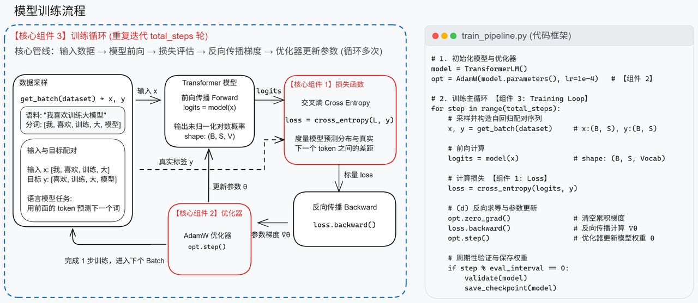
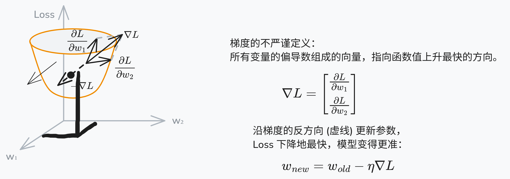
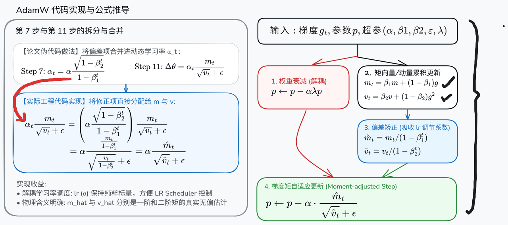
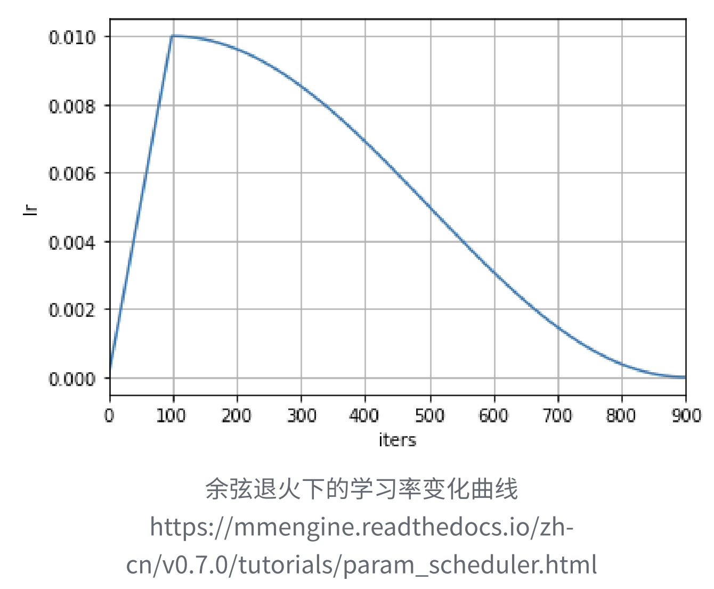

&emsp;&emsp;[CS336](https://cs336.stanford.edu/)的学习笔记，参考了b站[这就是小C_](https://space.bilibili.com/488678545/)，[intangible101](https://space.bilibili.com/3546747626326043)，[算法魔法师](https://space.bilibili.com/3546972082408260)的视频和笔记。

&emsp;&emsp;代码参考：[CS336 作业一代码文档（2_模型训练）](https://github.com/ddkeeper/easy-llm/tree/master/代码文档/第一章_构建一个Transformer模型/2_模型训练)；完整训练脚本见 [scripts/train_llm.py](https://github.com/ddkeeper/easy-llm/blob/master/scripts/train_llm.py)。

&emsp;&emsp; [Transformer 模型](/2026/08/01/CS336-1-Transformer模型/)输入token ID，输出每个位置的 next-token logits。但此时权重还是随机初始化的，模型的训练需要：

1. **损失函数**：用交叉熵衡量"模型预测的分布"和"真实下一个 token"差多远；
2. **优化器**：根据梯度决定参数往哪个方向、走多大一步，主流选择是 AdamW，并配合学习率调度与梯度裁剪；
3. **训练循环**：负责采样数据、前向反向、更新参数、评估、存盘。

### 训练流程

&emsp;&emsp;下图把三个核心组件放在了一起：



&emsp;&emsp;伪代码如下：

```text
for step in range(total_iters):
    x, y = get_batch(train_data, B, L)        # 采样一批数据，x/y: (B, L)
    lr = learning_rate_schedule(step)         # 本步学习率
    logits = model(x)                         # 前向：(B, L) -> (B, L, vocab_size)
    loss = cross_entropy(logits, y).mean()    # 逐位置损失取平均
    optimizer.zero_grad()                     # 清空上一步梯度
    loss.backward()                           # 反向传播，计算本步梯度
    gradient_clipping(model.parameters(), M)  # 梯度裁剪，防止单步更新过猛
    optimizer.step()                          # 用 AdamW 更新参数
```

&emsp;&emsp;下面按"损失 → 优化器 → 训练循环"的顺序，一块一块实现。
### 交叉熵损失

&emsp;&emsp;语言模型在每个位置 $i$ 输出一个长度为词表大小的 logits 向量 $o_i \in \mathbb{R}^{V}$，它只是未归一化的分数，还不是概率。经过 softmax 之后，词表中第 $a$ 个 token 的预测概率是：

$$
p_\theta(x_{i+1}\mid x_{1:i}) = \operatorname{softmax}(o_i)[x_{i+1}]
= \frac{\exp(o_i[x_{i+1}])}{\sum_{a=1}^{V}\exp(o_i[a])}
$$

&emsp;&emsp;训练目标就是让真实的下一个 token $x_{i+1}$ 的概率尽可能大。概率越接近 1，$-\log p$ 越接近 0；概率越接近 0，损失越大。对长度为 $m$ 的序列、整个数据集 $\mathcal{D}$ 的所有位置取平均：

$$
\ell(\theta;\mathcal{D})
= -\frac{1}{|\mathcal{D}|}\sum_{x\in\mathcal{D}}\frac{1}{m}\sum_{i=1}^{m}
\log p_\theta(x_{i+1}\mid x_{1:i})
$$

&emsp;&emsp;由于因果掩码的存在，模型一次前向就能同时得到所有位置的 next-token 分布，所以一次 `forward` 可以并行计算整条序列的损失，再一次性反向传播。这也是 Transformer 相比 RNN 更好训练的地方之一。


&emsp;&emsp;直接按定义计算会有数值问题：如果某个 logit 很大，$\exp(o_i[a])$ 可能上溢成 `inf`，分母也变成 `inf`，最后得到 `nan`。解决办法仍然是减最大值。令 $m_i=\max_a o_i[a]$，分子分母同乘 $e^{-m_i}$：

$$
p_\theta(x_{i+1}\mid x_{1:i})
= \frac{\exp(o_i[x_{i+1}]-m_i)}
{\sum_{a=1}^{V}\exp(o_i[a]-m_i)}
$$

&emsp;&emsp;此时所有指数项都满足 $o_i[a]-m_i \le 0$，$\exp(\cdot)\in(0,1]$，不会上溢。代回负对数，得到每个位置的损失：

$$
\ell_i
= -\left(o_i[x_{i+1}]-m_i\right)
+ \log\sum_{a=1}^{V}\exp\left(o_i[a]-m_i\right)
$$

&emsp;&emsp;这就是代码里要实现的 log-sum-exp 形式：第一项是"真实 token 的 logit 减去最大值"，第二项是"平移后指数和的 log"。

```python
# Problem 11: 实现交叉熵损失 (1 分)
def cross_entropy(logits: torch.Tensor, targets: torch.Tensor) -> torch.Tensor:
    '''
    logits: (..., seq_len, vocab_size), 通常为 (batch_size, seq_len, vocab_size)
    targets: (..., seq_len) (B, S)
    return: (B, S)，每个位置的交叉熵损失
    '''
    # 交叉熵损失的计算：-log softmax(o)[target] = -(o[target] - max(o)) + log Σ exp(o - max(o))
    # 先减最大值再取 exp 避免上溢，log 与 exp 相互抵消

    # 1.默认不保留归约后的维度；2. max 返回的是元组 (最大值, 最大值对应的下标)
    max_logits = logits.max(dim=-1)[0]  # (B, S, V) -> (B, S)

    # 在最后一维收集目标标签对应的 logit 值: logits[..., targets]
    target_logit = torch.gather(logits, -1, targets[..., None]).squeeze(-1)  # (B, S, V), (B, S, 1) -> (B, S)

    term1 = -(target_logit - max_logits)  # (B, S)

    exp_sum = torch.exp(logits - max_logits[..., None]).sum(dim=-1)  # (B, S, V), (B, S, V) -> (B, S)

    # 返回逐位置损失，训练时再 .mean() 得到标量
    return term1 + torch.log(exp_sum)  # (B, S)
```

&emsp;&emsp;几个实现细节：

1. **`max(dim=-1)[0]` 只取最大值，不要下标**。`torch.max` 返回的是 `(values, indices)` 命名元组，这里只需要 `values`；也可以写成 `.values` 或 `x.amax(dim=-1)`。
2. `gather` 负责"按目标下标取值"。`logits` 是 `(B, S, V)`，`targets` 是 `(B, S)`，`gather` 要求索引张量与输入张量维数相同，所以先 `unsqueeze(-1)` 成 `(B, S, 1)`，取完再 `squeeze(-1)` 还原成 `(B, S)`。它等价于对每个位置做 `logits[b, s, targets[b, s]]`，但不用写 Python 循环，也支持任意数量的前置 batch 维。
3. **广播方向要对齐**。`max_logits` 的形状是 `(B, S)`，直接和 `(B, S, V)` 相减时，PyTorch 会从最后一维往前对齐，把它当成 `(1, B, S)`，维度就错了；补一个 `[..., None]` 变成 `(B, S, 1)` 才是"每个位置减自己的最大值"。这与上一篇 softmax 里 `keepdim=True` 的道理完全一样。
4. **返回的是逐位置损失**。`cross_entropy` 返回 `(B, S)`，训练时再 `.mean()` 得到标量；真实训练中如果 batch 里有 padding，需要用 mask 把 padding 位置排除，否则会拉低平均损失。

&emsp;&emsp;实际工程里通常直接调用 `torch.nn.functional.cross_entropy(logits.flatten(0, -2), targets.flatten())`，它把 softmax 和 NLL 融合在一个核里，数值更稳、显存更省。这里手写一遍，是为了看清“减最大值 + log-sum-exp”到底在做什么。

#### 困惑度

&emsp;&emsp;交叉熵的绝对值不太直观，评估时更常用困惑度（perplexity, PPL）：

$$
\operatorname{perplexity}
= \exp\left(\frac{1}{m}\sum_{i=1}^{m}\ell_i\right)
= \exp(\bar{\ell})
$$


对 `(B, S)` 的逐位置损失，可以这样算：

```python
def cal_perplexity(loss: torch.Tensor) -> torch.Tensor:
    return torch.exp(loss.mean(dim=-1))  # (B, S) -> (B,)：每个样本的 PPL

ppl = torch.exp(loss.mean())             # 整个 batch 的 PPL
```

&emsp;&emsp;其中 $\bar{\ell}=\frac{1}{m}\sum_{i=1}^{m}\ell_i$ 是这条序列的平均交叉熵。困惑度可以理解为"模型在每个位置平均要在多少个 token 里犹豫"：

- 模型百分百猜对每个 token，$p=1$，困惑度为 1；
- 模型完全瞎猜，每个 token 概率都是 $1/V$，困惑度等于词表大小 $V$。

&emsp;&emsp;所以 PPL 越低越好，且它和词表大小强相关：不同分词器训练出的模型，PPL 不能直接横向比较，比较 per-token 损失或换算到 per-byte 损失才公平。

### 优化器

&emsp;&emsp;有了损失，接下来要沿着损失下降的方向更新参数。梯度 $\nabla_\theta\mathcal{L}$ 指向损失上升最快的方向，所以往反方向走：

$$
\theta_{t+1} = \theta_t - \alpha_t \nabla_\theta \mathcal{L}(\theta_t;\mathcal{B}_t)
$$

&emsp;&emsp;其中 $\mathcal{B}_t$ 是从训练集里随机采样的一批数据，$\alpha_t$ 是学习率。因为每步只用一小批样本估计梯度，所以叫随机梯度下降（Stochastic Gradient Descent, SGD）。



&emsp;&emsp;优化器大致发展如下：SGD → Momentum → AdaGrad → RMSProp → Adam → AdamW。Momentum 用一阶动量抑制震荡；AdaGrad/RMSProp 用梯度平方的滑动平均给每个参数一套自适应步长；Adam 把动量和二阶矩结合并做偏差校正；AdamW 再把权重衰减从自适应步长里解耦。更完整的推导和直观讲解可以参考[这个视频](https://www.bilibili.com/video/BV1sgivBFEDq/)。

&emsp;&emsp;下面先实现一个最基础的 SGD 变体，借它熟悉 PyTorch 优化器的 API；再实现现代大模型普遍使用的 AdamW；最后说明两个稳定训练的手段——学习率调度和梯度裁剪。

#### SGD 与 PyTorch 优化器 API

&emsp;&emsp;PyTorch 里所有优化器都继承 `torch.optim.Optimizer`，只要实现两个方法：

- `__init__(self, params, ...)`：调用基类 `super().__init__(params, defaults)`，保存待优化参数和默认超参；
- `step(self)`：执行一次参数更新，通常在 `loss.backward()` 之后调用。

&emsp;&emsp;基类帮我们维护了两个关键容器：

- `self.param_groups`：一个列表，每个元素是一组参数的字典（包含 `params` 和该组的超参）。分组的意义是不同层可以用不同学习率，比如微调时底层小、顶层大。
- `self.state`：一个字典，以参数张量为 key，保存该参数自己的状态，比如迭代步数 `t`、一阶矩 `m`、二阶矩 `v`。

&emsp;&emsp;可以把两个容器近似看成下面这样的结构。

**（1）`param_groups`：一个列表，每个元素是一组参数 + 一组超参**

```text
param_groups = [
    {
        "params": [w1, b1],      # 这一组包含哪些参数张量
        "lr": 0.001,             # 这一组的学习率
        "momentum": 0.9,         # 其他超参，通常来自 defaults
        ...
    },
    {
        "params": [w2, b2],
        "lr": 0.01,
        "momentum": 0.9,
        ...
    },
]
```

&emsp;&emsp;如果只传 `model.parameters()`，列表里就只有一组，所有参数共用同一套超参；如果手动传入多个字典，就可以让不同层用不同 `lr`。`step()` 里按组遍历，读 `group["lr"]` 和 `group["params"]`，所以分组本质上是“一组参数 + 一组超参”。训练中改学习率，也就是改 `group["lr"]`。

**（2）`state`：一个字典，key 是参数对象，value 是该参数的状态**

```text
state = {
    w1: {"t": 10, "m": ..., "v": ...},   # AdamW：步数、一阶矩、二阶矩
    b1: {"t": 10, "m": ..., "v": ...},
    w2: {"t": 10, "m": ..., "v": ...},
    b2: {"t": 10, "m": ..., "v": ...},
}
```

&emsp;&emsp;如果是 SGD + Momentum，value 里通常只有 `{"momentum_buffer": ...}`；换成 AdamW，就变成 `{"step": ..., "exp_avg": ..., "exp_avg_sq": ...}`。每个参数的 `m`、`v` 都和该参数形状相同，所以参数量翻倍地占显存。

&emsp;&emsp;`state` 是懒初始化的：第一次 `step()` 之前是空字典；自定义优化器里用 `state = self.state[p]` 取出状态字典，再用 `state.get("m", 0)`、`state.get("v", 0)`、`state.get("t", 0)` 取默认值，第一次 `step` 时会自然初始化。

```python
import torch
import math
from collections.abc import Callable, Iterable
from typing import Optional

# 这套 API 约定同样适用于下一节的 AdamW
class SGD(torch.optim.Optimizer):
    '''
    PyTorch 中的优化器统一继承 torch.optim.Optimizer，需要实现两个方法：
    __init__(self, params, ...): 使用基类的 init 方法保存待优化参数和默认超参；
    step(self): 执行一次参数更新
    '''

    def __init__(self, params, lr=1e-3):
        """
        自定义SGD优化器构造函数
        :param params: 待优化的参数集合，可以是模型全部参数，也可以是分组参数
        :param lr: 学习率，超参数
        """
        if lr < 0:
            raise ValueError(f"Invalid learning rate: {lr}")
        defaults = {"lr": lr}  # 以字典的形式存储超参名（key）与超参默认值（value)
        super().__init__(params, defaults)

    def step(self, closure: Optional[Callable] = None):
        """
        执行单步参数更新，反向传播完成 grad 计算之后调用此函数
        :param closure: 可选的闭包函数，用于重新计算 loss 并返回 loss 值，部分优化器需要使用（我们不用）
        :return: 如果传入 closure，返回 loss，否则返回 None
        """
        loss = None if closure is None else closure()
        for group in self.param_groups:  # 遍历不同的参数组: 不同组可以指定不同的超参数，比如第一层参数用小一点的 lr，最后一层用大一点的 lr
            lr = group["lr"]  # group 也是一个字典，取其中的 lr
            for p in group["params"]:  # 遍历该组内的每个待优化参数 p
                if p.grad is None:  # 梯度还没有计算出来，grad 属性为 None，跳过更新
                    continue

                state = self.state[p]  # self.state 字典：保存每个参数对应的状态信息，如迭代步数、动量等；state[p] 获取参数 p 对应的状态字典
                t = state.get("t", 0)  # 读取迭代计数 t；如果 key "t" 不存在，返回默认值 0
                grad = p.grad.data  # 获取损失 loss 关于参数 p 的梯度张量
                p.data -= lr / math.sqrt(t + 1) * grad  # 原地更新参数：学习率随迭代步数做平方根衰减
                state["t"] = t + 1  # 更新状态里的迭代计数，步数 +1

        return loss


# 测试 SGD：对比不同学习率下 toy 损失的收敛情况
for lr in [1e1, 1e2, 1e3]:  # 1*10 1*10^2 1*10^3
    weights = torch.nn.Parameter(5 * torch.randn((10, 10)))
    opt = SGD([weights], lr=lr)
    print(f"--- lr={lr} ---")
    for t in range(10):
        opt.zero_grad()             # 清空上一步的梯度
        loss = (weights**2).mean()  # 构造一个标量损失
        loss.backward()             # 反向传播，计算梯度
        opt.step()                  # 优化器更新参数
        if t % 3 == 0 or t == 9:
            print(f"  step {t:2d}: loss = {loss.item():.3e}")
```

- `lr=1e1`：因子约为 0.8 起步，损失平稳下降，10 步内大约从 24 降到 3；
- `lr=1e2`：前几步的更新因子绝对值接近 1，参数来回翻符号；随着学习率按 $1/\sqrt{t+1}$ 衰减，$t=3$ 这一步的更新因子正好变成 0，更新后参数被直接推到 0，损失很快降到 $2\times10^{-23}$——这不是"学好了"，而是参数被抹平了；
- `lr=1e3`：更新步长远远超过参数本身，损失迅速涨到 $2\times10^{18}$，直接发散。

&emsp;&emsp;这个实验说明：学习率必须和参数初始化的量级、损失曲面的曲率匹配。太小收敛慢，太大震荡甚至发散，这也是后面要做 warmup 和余弦退火的原因。

#### AdamW 优化器

&emsp;&emsp;Adam 系列给每个参数维护一套"自己的"学习率，用一阶矩和二阶矩的滑动平均来估计梯度的均值和方差，每个参数额外保存两个与参数同形状的张量：

- $m_t$：一阶矩，梯度的指数滑动平均，相当于动量，记录"最近主要往哪走"；
- $v_t$：二阶矩，梯度平方的指数滑动平均，记录"最近梯度有多大"。

&emsp;&emsp;更新公式如下：

$$
m_t = \beta_1 m_{t-1} + (1-\beta_1)g_t
$$

$$
v_t = \beta_2 v_{t-1} + (1-\beta_2)g_t^2
$$

$$
\hat{m}_t = \frac{m_t}{1-\beta_1^t},
\qquad
\hat{v}_t = \frac{v_t}{1-\beta_2^t}
$$

$$
\theta_t = \theta_{t-1} - \alpha\left(\lambda\theta_{t-1}
+ \frac{\hat{m}_t}{\sqrt{\hat{v}_t}+\epsilon}\right)
$$

&emsp;&emsp;其中 $g_t=\nabla_\theta\mathcal{L}(\theta_{t-1};\mathcal{B}_t)$，$\alpha$ 是学习率，$(\beta_1,\beta_2)$ 是两个衰减率，$\lambda$ 是权重衰减系数，$\epsilon$ 是防止除零的小常数。


&emsp;&emsp;有几个设计点值得展开：

1. **偏差校正**。$m_0=v_0=0$，如果直接使用，训练初期的 $m_t$、$v_t$ 会被 0 拉低，估计偏小。除以 $1-\beta_1^t$ 和 $1-\beta_2^t$ 正好把初始的零偏修正回来。
2. **自适应步长**。更新量大致是 $\hat{m}_t/\sqrt{\hat{v}_t}$，量级接近 1：梯度持续很大的参数，分母也大，实际步长被压小；梯度稀疏或很小的参数，分母小，反而能获得更大的相对步长。
3. **解耦权重衰减**。L2 正则会把 $\lambda\theta$ 加进梯度，再被自适应分母缩放，导致大梯度参数的衰减反而变弱。AdamW 把权重衰减单独拿出来，直接对参数做 $\theta\leftarrow\theta-\alpha\lambda\theta$，与梯度统计解耦，这也是它和 Adam + L2 的关键区别。


```python
# Problem 13:  实现 AdamW (2 分)
class AdamW(torch.optim.Optimizer):
    def __init__(self, params, lr:float = 1e-3, betas:tuple[float, float] = (0.9, 0.999), eps:float = 1e-8, weight_decay:float = 0.0):
        '''
        lr: float  α, learning‑rate 学习率
        betas: tuple[float, float] (β1, β2), 一阶矩、二阶矩估计的指数衰减系数
        eps: float ε, 保证数值稳定性的小常数
        weight_decay: float λ, weight‑decay 权重衰减系数
        '''
        if lr < 0:
            raise ValueError(f"Invalid learning rate: {lr}")

        # defaults 字典保存优化器的默认超参数
        defaults = {"lr": lr, "betas": betas, "eps": eps, "weight_decay": weight_decay}

        # 调用父类 Optimizer 的构造函数
        super().__init__(params, defaults)

    def step(self, closure: Optional[Callable] = None):
        """
        执行单步 AdamW 参数更新，反向传播计算完梯度后调用
        :param closure: 可选闭包函数，用于重计算 loss
        :return: loss，若传入 closure 返回 loss，否则返回 None
        """
        loss = None if closure is None else closure()

        for group in self.param_groups:
            lr = group["lr"]
            beta1, beta2 = group["betas"]
            eps = group["eps"]
            weight_decay = group["weight_decay"]

            for p in group["params"]:
                if p.grad is None:
                    continue

                state = self.state[p]
                t = state.get("t", 0)
                m = state.get("m", 0)
                v = state.get("v", 0)
                grad = p.grad.data

                t += 1

                # 执行 AdamW 单步更新
                p.data -= lr * weight_decay * p.data  # 权重衰减：单独对参数做衰减
                m_t = beta1 * m + (1 - beta1) * grad  # 一阶矩
                v_t = beta2 * v + (1 - beta2) * grad ** 2  # 二阶矩
                m_hat = m_t / (1 - beta1 ** t)  # 偏差校正
                v_hat = v_t / (1 - beta2 ** t)
                p.data -= lr * m_hat / (torch.sqrt(v_hat) + eps)

                state["t"] = t
                state["m"] = m_t
                state["v"] = v_t

        return loss
```

&emsp;&emsp;超参选择上，$(\beta_1,\beta_2)=(0.9,0.999)$ 是 Adam 的经典默认值；LLaMA、GPT-3 这类大模型常用 $(0.9,0.95)$，因为训练 token 多、梯度噪声大，二阶矩衰减快一点能更快适应最近的变化。`eps` 一般取 `1e-8`，权重衰减 `0.1` 左右。

&emsp;&emsp;代价是显存：每个参数除了自身的权重和梯度，还要再存 $m$、$v$ 两份同形状的状态。以 1B 参数、FP32 为例，仅 $m$ 和 $v$ 就要 $2\times4\text{GB}=8\text{GB}$，这还没算权重、梯度和激活值。后面做混合精度、ZeRO、梯度检查点时，优化器状态往往是显存占用的大头。

#### 学习率调度

&emsp;&emsp;让损失下降最快的学习率在训练过程中并不是常数。训练初期参数随机、梯度方向不稳定，一上来就用大学习率容易发散；训练后期已经接近一个好的区域，需要小学习率精细收敛。Transformer 的惯例是"先预热、再余弦衰减"：

$$
\alpha_t =
\begin{cases}
\dfrac{t}{T_w}\,\alpha_{\max}, & t < T_w \\[8pt]
\alpha_{\min} + \dfrac{1+\cos\left(\pi\dfrac{t-T_w}{T_c-T_w}\right)}{2}
\left(\alpha_{\max}-\alpha_{\min}\right), & T_w \le t \le T_c \\[8pt]
\alpha_{\min}, & t > T_c
\end{cases}
$$

&emsp;&emsp;其中 $\alpha_{\max}$、$\alpha_{\min}$ 是最大与最小学习率，$T_w$ 是预热步数，$T_c$ 是余弦退火结束的步数。三个阶段分别是：

1. **线性预热**：从 0 线性升到 $\alpha_{\max}$，让模型先"稳住"；
2. **余弦退火**：按余弦曲线从 $\alpha_{\max}$ 平滑降到 $\alpha_{\min}$，两端平缓、中间下降较快；
3. **保持最小学习率**：超过 $T_c$ 后不再下降，避免学习率变成 0 后完全停止学习。



&emsp;&emsp;为什么要 warmup？训练刚开始时，Adam 的 $v_t$ 还是 0 附近的小值，偏差校正虽然能修正期望，但估计的方差很大；再加上参数随机初始化，少数样本可能产生方向完全错误的梯度。如果此时直接用 $\alpha_{\max}$，一步就可能把参数推到很坏的区域。先用小学习率跑几百步，让 $m$、$v$ 的估计稳定下来，再逐渐加速，训练会稳很多。

```python
# Problem 14: 实现带预热的余弦学习率调度 (1 分)
def learning_rate_schedule(
    it: int,
    max_learning_rate: float,
    min_learning_rate: float,
    warmup_iters: int,
    cosine_cycle_iters: int,
):
    '''
    it: int  当前迭代步数 t
    max_learning_rate: float  α_max，最大学习率
    min_learning_rate: float  α_min，最小（最终）学习率
    warmup_iters: int  T_w，预热迭代数
    cosine_cycle_iters: int  T_c，余弦退火的结束迭代
    return: float，第 it 步使用的学习率 α_t
    '''
    # 1. 预热：学习率从 0 线性升到最大值
    if it < warmup_iters:
        return max_learning_rate * it / warmup_iters

    # 2. 余弦退火：从最大值平滑降到最小值
    if it <= cosine_cycle_iters:
        progress = (it - warmup_iters) / (cosine_cycle_iters - warmup_iters)
        cosine = 0.5 * (1 + math.cos(math.pi * progress))
        return min_learning_rate + cosine * (max_learning_rate - min_learning_rate)

    # 3. 退火结束：保持最小学习率
    return min_learning_rate
```
&emsp;&emsp;实际配置里，`max_lr` 常取 `1e-3` 到 `1e-4`，`min_lr` 取最大值的 10% 左右，`warmup_iters` 取总步数的 1%～5%。这些值没有理论最优，需要结合模型大小、batch size 和数据量做超参搜索。

#### 梯度裁剪

&emsp;&emsp;训练中偶尔会遇到"异常样本"：某个 batch 的损失特别大，反传回来的梯度范数可能是正常值的几十上百倍。哪怕只有一步，也可能把参数和 Adam 的 $m$、$v$ 一起带偏，甚至直接导致 loss 爆炸。梯度裁剪的做法是给梯度的整体范数设一个上限 $M$：

$$
\|g\|_2 = \sqrt{\sum_i \|\nabla_{\theta_i}\mathcal{L}\|_2^2},
\qquad
g \leftarrow \frac{M}{\|g\|_2+\varepsilon}\,g
\quad (\|g\|_2 \ge M)
$$

&emsp;&emsp;如果 $\|g\|_2 < M$，说明梯度正常，不做任何处理。注意范数是对**所有参数拼成的一个整体向量**计算的，而不是每个参数张量各自算一次；否则每个张量都被单独裁剪，整体范数仍然可能很大。$\varepsilon$ 取 PyTorch 默认的 `1e-6`，防止分母为 0，同时让裁剪后的范数略小于 $M$。

```python
# Problem 15: 实现梯度裁剪 (1 分)
def gradient_clipping(parameters: Iterable[torch.nn.Parameter], max_l2_norm: float, eps: float = 1e-6) -> None:
    '''
    parameters: 待裁剪梯度的参数集合（或参数组）
    max_l2_norm: float  M，允许的梯度最大 ℓ2 范数
    '''
    # model.parameters() 返回一次性迭代器；先保存下来，后续才能分别计算范数和缩放梯度
    parameters = [p for p in parameters if p.grad is not None]

    # 把所有参数的梯度当成一个大向量，计算整体的 ℓ2 范数
    l2_norm = math.sqrt(sum(p.grad.pow(2).sum().item() for p in parameters))

    # 只在范数超过阈值时整体按比例缩放，方向保持不变（原地修改）
    if l2_norm > max_l2_norm:
        for p in parameters:
            with torch.no_grad():
                p.grad *= max_l2_norm / (l2_norm + eps)
```

&emsp;&emsp;裁剪的位置很关键：必须在 `loss.backward()` 之后、`optimizer.step()` 之前。如果放在 `backward()` 之前，梯度还没算出来；如果放在 `step()` 之后，参数已经被异常梯度更新过了。PyTorch 也提供了 `torch.nn.utils.clip_grad_norm_(model.parameters(), M)`，实现逻辑与上面一致。
### 训练循环

&emsp;&emsp;损失、优化器、学习率调度、梯度裁剪都齐了，但还差三件支撑设施：

1. **数据加载**：从一整条 token 序列里随机采样一批 `(输入, 目标)`；
2. **检查点**：把模型、优化器状态和迭代步数存到磁盘，训练断了能恢复；
3. **训练循环**：把前向、反向、更新、评估、日志串成一个可反复执行的循环。

#### 数据加载

&emsp;&emsp;原始文本经过分词后，会变成一条很长的 token 序列 $x=(x_1,\dots,x_n)$。不同文档之间通常插入 `<|endoftext|>` 作为分隔符，它也有自己的 token ID。数据加载器的任务，是从这条长序列里随机选 $B$ 个起点，每个起点取长度为 $L$ 的输入，以及整体右移一格的目标：

$$
\text{input} = (x_s, x_{s+1}, \dots, x_{s+L-1}),
\qquad
\text{target} = (x_{s+1}, x_{s+2}, \dots, x_{s+L})
$$

&emsp;&emsp;目标就是输入右移一位：第 $i$ 个位置要预测第 $i+1$ 个 token。这样一条序列一次前向就能提供 $L$ 个训练信号，不需要为每个位置单独切样本。


&emsp;&emsp;图中 `batch_size=2`、`context_length=3`，随机抽到起点 1 和 4，于是输入是 `[x1,x2,x3]` 和 `[x4,x5,x6]`，目标分别是 `[x2,x3,x4]` 和 `[x5,x6,x7]`。不同样本之间可以重叠，这没有关系——每个样本只是从长序列里截取的一段窗口。

```python
# Problem 16: 实现数据加载 (2 分)
def get_batch(x: np.ndarray,
              batch_size: int,
              context_length: int,
              device: str) -> tuple[torch.Tensor, torch.Tensor]:
    '''
    x: np.ndarray  一维整数数组，元素为 token ID
    batch_size: int  B，批大小
    context_length: int  L，每条句子的上下文长度
    device: str  设备字符串，如 'cpu' 或 'cuda:0'
    returns (input_seq, target_seq), 形状为 (batch_size, context_length)
    '''
    # 随机采样 B 个起始下标：取值范围 [0, len(x) - L)，保证往后取 L 个 token 不会越界
    indices = np.random.randint(0, len(x) - context_length, size=batch_size)

    # indices[:, None] 将形状从 (B,) 变成 (B, 1)，与 (L,) 广播相加后得到 (B, L)
    input_seq = x[indices[:, None] + np.arange(0, context_length)]  # (B, L)

    indices += 1  # target_seq 的起始下标全部加 1，相当于整体右移一格
    target_seq = x[indices[:, None] + np.arange(0, context_length)]  # (B, L)

    # 转成 torch 张量并放到指定设备上
    input_seq_tensor = torch.tensor(input_seq, device=device)
    target_seq_tensor = torch.tensor(target_seq, device=device)

    return (input_seq_tensor, target_seq_tensor)
```

&emsp;&emsp;几个细节：

- **上界是 `len(x) - context_length`**。`np.random.randint` 的上界是开区间，所以起点最大是 `len(x)-L-1`；输入取 `L` 个 token，目标再用 `indices += 1` 右移一格，最后一个目标下标正好是 `len(x)-1`。
- **`indices[:, None] + np.arange(0, L)` 是广播**。`(B,1)` 加 `(L,)` 得到 `(B,L)`，每一行就是一个样本的连续窗口；再用这个二维索引去取 `x`，一次性取出整批，不需要 Python 循环。
- **类型转换放在训练入口**。这里先转普通张量，训练时再 `.long()`；也可以直接写成 `torch.tensor(..., dtype=torch.long, device=device)`，效果一样。
- **大数据集用 `np.memmap`**。如果 token 序列有几个 GB，`np.load(path, mmap_mode='r')` 会把文件映射成"看起来在内存里"的数组，访问哪个窗口才加载哪一段磁盘内容，不会一次性占满内存。上面的花式索引只读取被选中的那几段，正好适合 memmap。

#### 检查点保存与加载

&emsp;&emsp;训练可能被打断（机器重启、显存溢出、任务被抢占），也可能想拿中间模型做分析、对比不同阶段的生成效果。所以需要定期把训练状态存到磁盘。一个合格的检查点必须包含三样东西：

1. **模型权重**：`model.state_dict()` 返回全部可学习参数和 buffer（比如 RoPE 的 `cos_table`、`sin_table`），加载时用 `load_state_dict()` 装回去；
2. **优化器状态**：AdamW 的 $m$、$v$、$t$ 都在 `optimizer.state_dict()` 里，不恢复的话，续训时动量会从 0 重新开始，训练曲线会出现明显抖动；
3. **迭代步数**：记录走到哪一步，学习率调度和日志都依赖它。

```python
# Problem 17: 实现模型检查点保存与加载 (1 分)
import os
import typing
import torch

from torch.nn import Module
from torch.optim import Optimizer


def save_checkpoint(model: Module,
                    optimizer: Optimizer,
                    iteration: int,
                    out: str | os.PathLike | typing.BinaryIO | typing.IO[bytes]) -> None:
    '''
    model: torch.nn.Module  模型
    optimizer: torch.optim.Optimizer  优化器
    iteration: int  当前的迭代步数
    out: 保存路径或文件对象
    '''
    # state_dict() 返回保存全部可学习权重的字典；优化器同理（AdamW 的 m / v 等状态也在里面）
    torch.save(
        {
            "model": model.state_dict(),      # 模型权重
            "optim": optimizer.state_dict(),  # 优化器状态
            "iter_num": iteration,            # 迭代步数：恢复学习率调度要用
        }
        , out)


def load_checkpoint(src: str | os.PathLike | typing.BinaryIO | typing.IO[bytes],
                    model: Module,
                    optimizer: Optimizer = None) -> int:
    '''
    src: 检查点路径或文件对象
    model: torch.nn.Module
    optimizer: torch.optim.Optimizer
    returns: int，检查点中保存的迭代步数
    '''
    device = next(model.parameters()).device   # 加载到模型当前所在的设备上
    state_dic = torch.load(src, map_location=device, weights_only=True)
    model.load_state_dict(state_dic["model"])
    if optimizer is not None:
        optimizer.load_state_dict(state_dic["optim"])

    return state_dic["iter_num"]
```

&emsp;&emsp;几个工程上的注意点：

- **存 `state_dict()`，不要直接 `torch.save(model)`**。前者只保存张量和结构信息，不依赖类的定义，换代码、换目录都能加载；后者会把整个 Python 对象 pickle 进去，重构模型后经常加载失败。
- **`map_location` 不能省**。在 GPU 上存的检查点拿到 CPU 上加载时，不加 `map_location` 会尝试分配 CUDA 显存并报错；反过来也一样。
- **优化器状态是可选的**。如果只是做推理，传 `optimizer=None` 即可，省一点加载时间；如果要续训，必须把优化器状态一起恢复。
- **保存路径建议加上步数**，比如 `checkpoint_5000.pt`，否则每次覆盖同一个文件，出问题后没有历史版本可回退。实际工程里还会用"临时文件 + 原子重命名"避免保存到一半断电导致文件损坏。

#### 组装完整训练循环

&emsp;&emsp;推荐把训练拆成两层：`train_step()` 只负责一次参数更新，`train_llm()` 负责循环、调度、评估和存盘。这样单步逻辑可以单独测试，训练循环也不会太长。

```python
# Problem 18: 组装完整训练循环 (4 分)
def train_step(
    model: torch.nn.Module,
    optimizer: torch.optim.Optimizer,
    x: torch.Tensor,
    y: torch.Tensor,
    lr: float,
    max_l2_norm: float = 1.0,
) -> float:
    '''
    model: torch.nn.Module  语言模型
    optimizer: torch.optim.Optimizer  优化器
    x: (batch_size, context_length)  输入 token ID，需为 long 类型
    y: (batch_size, context_length)  目标 token ID，即 x 整体右移一格
    lr: float  本步使用的学习率（由余弦调度给出）
    max_l2_norm: float  M，梯度裁剪允许的最大 ℓ2 范数
    return: float  本步的损失值（标量）
    '''
    # 余弦调度给出的学习率，必须在 step 之前写进去
    optimizer.param_groups[0]["lr"] = lr

    logits = model(x)                       # (B, L, vocab_size) 前向传播
    loss = cross_entropy(logits, y).mean()  # 对所有位置取平均，得到标量损失

    optimizer.zero_grad()                   # 清空上一步的梯度
    loss.backward()                         # 反向传播，计算梯度
    gradient_clipping(model.parameters(), max_l2_norm)  # 梯度裁剪
    optimizer.step()                        # 更新参数

    return loss.item()
```

&emsp;&emsp;`zero_grad()` 的位置值得说明：PyTorch 的梯度是**累加**的，`backward()` 会把本步梯度加到 `.grad` 上，而不是覆盖。所以每次 `backward()` 之前必须清空上一次的梯度，否则相当于把多个 batch 的梯度加在一起，等效于放大了 batch size，学习率也要跟着改。放在 `loss` 计算之后、`backward()` 之前是可以的，因为此时还没有发生本步的反向传播；放在前向之前也常见，两种写法都对。

```python
# 训练循环：反复调用 train_step
def train_llm(
    model: torch.nn.Module,
    optimizer: torch.optim.Optimizer,
    train_data: np.ndarray,
    val_data: np.ndarray,
    args,
    start_iter: int = 1,
) -> None:
    '''
    model / optimizer: 模型与优化器
    train_data / val_data: np.ndarray  token ID 数组，建议用 np.load(路径, mmap_mode='r') 打开
    args: 超参集合，建议用 argparse 以命令行参数的形式接收
    start_iter: int  从第几步开始训练；断点续训时传 load_checkpoint 的返回值 + 1
    '''
    for i in range(start_iter, args.total_iters + 1):
        model.train()  # 切到训练模式（dropout、BatchNorm 等层的行为会不同）

        # 1. 取一批训练数据，并按余弦调度算出本步学习率
        x, y = get_batch(train_data, args.batch_size, args.context_length, args.device)
        lr = learning_rate_schedule(
            i, args.max_lr, args.min_lr,
            args.warmup_iters, args.cosine_cycle_iters,
        )

        # 2. 单步训练：前向 → 损失 → 反向 → 裁剪 → 更新
        loss = train_step(model, optimizer, x.long(), y.long(), lr=lr, max_l2_norm=args.max_l2_norm)

        # 3. 定期记录训练日志
        if i % args.log_interval == 0:
            print(f"iter {i:6d} | train_loss {loss:.4f} | lr {lr:.2e}")

        # 4. 定期在验证集上评估、保存检查点
        if i % args.val_interval == 0:
            model.eval()  # 切到评估模式
            total_loss = 0.0
            with torch.no_grad():  # 验证不构建计算图，省显存也更快
                for _ in range(args.val_batches):
                    vx, vy = get_batch(
                        val_data, args.batch_size, args.context_length, args.device
                    )
                    total_loss += cross_entropy(model(vx), vy).mean().item()
            val_loss = total_loss / args.val_batches
            print(f"iter {i:6d} | val_loss {val_loss:.4f} | ppl {math.exp(val_loss):.2f}")
            # 实际实验可以把路径改成 f"checkpoint_{i}.pt"，保留历史版本
            save_checkpoint(model, optimizer, i, args.checkpoint_path)
```

&emsp;&emsp;验证集评估最好固定使用同一批窗口，比如训练开始前先采样好 `val_x`、`val_y`，之后每轮复用。否则每次 `get_batch` 都重新随机采样，验证损失会额外抖动，不同实验的曲线不好比较。

&emsp;&emsp;最后补上命令行入口。用 `argparse` 接收超参，跑对比实验时只需要改命令行参数，不用改代码；数据用 `np.load(..., mmap_mode='r')` 打开，避免把整个 token 文件读进内存：

```python
import argparse


def parse_args():
    parser = argparse.ArgumentParser()

    # 数据与保存路径
    parser.add_argument("--train_data", type=str, required=True)
    parser.add_argument("--val_data", type=str, required=True)
    parser.add_argument("--checkpoint_path", type=str, default="checkpoint.pt")
    parser.add_argument("--resume", type=str, default=None)

    # 设备与模型
    parser.add_argument("--device", type=str,
                        default="cuda:0" if torch.cuda.is_available() else "cpu")
    parser.add_argument("--batch_size", type=int, default=32)
    parser.add_argument("--context_length", type=int, default=256)

    # 训练长度与学习率调度
    parser.add_argument("--total_iters", type=int, default=10000)
    parser.add_argument("--max_lr", type=float, default=1e-3)
    parser.add_argument("--min_lr", type=float, default=1e-4)
    parser.add_argument("--warmup_iters", type=int, default=100)
    parser.add_argument("--cosine_cycle_iters", type=int, default=9000)
    parser.add_argument("--max_l2_norm", type=float, default=1.0)

    # 日志与验证
    parser.add_argument("--log_interval", type=int, default=10)
    parser.add_argument("--val_interval", type=int, default=500)
    parser.add_argument("--val_batches", type=int, default=20)

    return parser.parse_args()


if __name__ == "__main__":
    args = parse_args()

    # memmap：访问哪个窗口才加载哪一段，适合几个 GB 的 token 文件
    train_data = np.load(args.train_data, mmap_mode="r")
    val_data = np.load(args.val_data, mmap_mode="r")

    model = TransformerLM(
        d_model=512,
        num_heads=16,
        d_ff=1344,
        vocab_size=10000,
        context_length=args.context_length,
        num_layers=4,
        rope_theta=10000.0,
    ).to(args.device)

    optimizer = AdamW(
        model.parameters(),
        lr=args.max_lr,
        betas=(0.9, 0.95),
        eps=1e-8,
        weight_decay=0.1,
    )

    # 断点续训：恢复模型、优化器，并从保存步数的下一步继续
    start_iter = 1
    if args.resume is not None:
        start_iter = load_checkpoint(args.resume, model, optimizer) + 1

    train_llm(model, optimizer, train_data, val_data, args, start_iter=start_iter)
```

&emsp;&emsp;至此，训练所需的最小闭环就完整了：

```text
get_batch → model.forward → cross_entropy → loss.backward
         → gradient_clipping → optimizer.step → 记录/存盘
```

### 小结

&emsp;&emsp;这一篇把"模型怎么学"拆成了三块，每块对应一组可以独立测试的函数：

| 模块 | 核心函数 / 类 | 作用 |
| --- | --- | --- |
| 损失 | `cross_entropy` | 用 log-sum-exp 稳定计算 next-token 交叉熵 |
| 优化器 | `SGD`、`AdamW` | 按梯度更新参数，AdamW 额外维护一阶矩、二阶矩 |
| 学习率 | `learning_rate_schedule` | 线性 warmup + 余弦退火，前期稳、后期细 |
| 稳定性 | `gradient_clipping` | 限制全局梯度范数，防止单步更新过猛 |
| 数据 | `get_batch` | 从长 token 序列随机截取 `(输入, 右移一格的目标)` |
| 状态 | `save_checkpoint` / `load_checkpoint` | 保存模型、优化器状态和迭代步数 |
| 循环 | `train_step` / `train_llm` | 把前向、反向、裁剪、更新、评估、存盘串起来 |

&emsp;&emsp;几个容易混淆的点再强调一次：

- **交叉熵先减最大值，再算 log-sum-exp**，这不是近似，而是数学等价且数值稳定的写法；
- **AdamW 的权重衰减是解耦的**，直接作用于参数，不经过自适应分母；
- **梯度裁剪算的是全局范数**，所有参数拼成一个向量，裁剪发生在 `backward()` 之后、`step()` 之前；
- **检查点必须包含优化器状态和迭代步数**，只存模型权重无法无损续训；
- **训练和评估要切换 `model.train()` / `model.eval()`**，验证时包在 `torch.no_grad()` 里。

&emsp;&emsp;有了这套循环，就可以在真实语料上训练模型，观察 loss 曲线、做超参搜索和消融实验，最后用训练好的检查点做自回归生成。接下来的实验会在 TinyStories 上把这条训练与推理解码的链路完整跑通。
